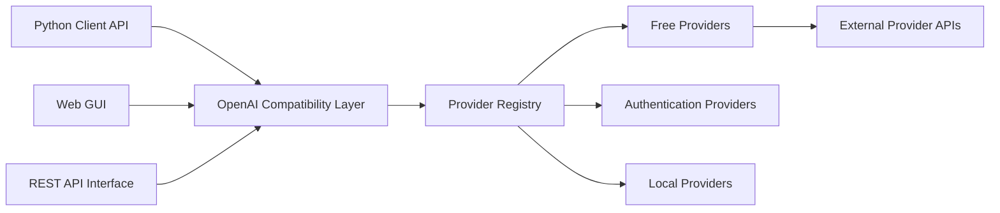

# xtekky/gpt4free

> Community aggregator of third-party LLM providers behind an OpenAI-compatible API, a GUI and clients.

## The problem
Wanting to call several LLMs and image generators through a single interface, without managing one key per provider.

## What it actually does
A Python client (sync and async), a web GUI, an OpenAI-compatible FastAPI API ("Interference API"), a JavaScript client and an MCP server (web search, scraping, images).
Everything goes through a provider registry: free, authenticated (cookies and HAR files mounted in `har_and_cookies`), local, deprecated. Some providers drive Chrome; a VNC desktop (port 7900) is used for manual logins.
The architecture analysis provided is generic: few real files cited.

## How it is wired


## Trying it
```bash
docker pull hlohaus789/g4f
pip install -U g4f[all]
python -m g4f.cli gui --port 8080 --debug
python -m g4f --port 8080 --debug
g4f mcp
```

## Cost and gotchas
Free, GPL-3.0; Chrome/Chromium for some providers; `--shm-size` to increase for browser automation. Everything depends on third-party services outside your control.

## What it is not
Not an official API: an aggregator of "accessible" providers, whose availability is not guaranteed. The README contains a takedown policy: a signal about the legal status of some accesses.

## Alternatives
No alternative named in the README.

## For you
Ignore for any serious work: fragile foundation, unclear status of the accesses.
