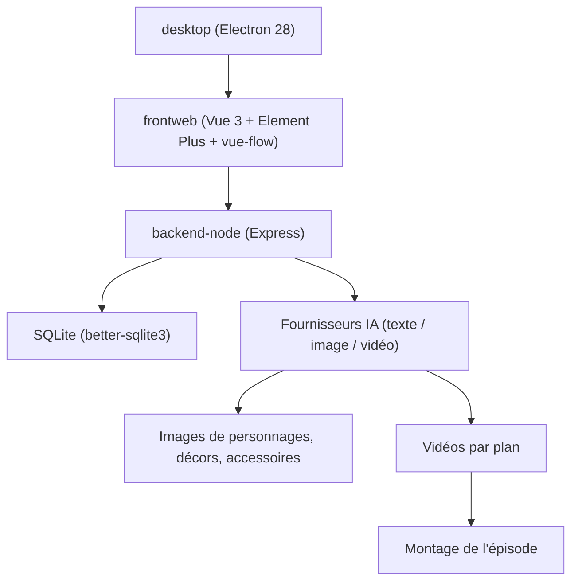

# xuanyustudio/LocalMiniDrama

> Local tool for creating AI short films: script, characters, storyboard, editing.

## The problem
AI short-film tools are subscription SaaS products, and both your footage and your scripts go to their servers.

## What it actually does
A complete eight-step pipeline: story generation from a synopsis and a style, per-episode script editing, extraction and generation of character images, extraction of sets, generation of props, per-episode storyboard (with shot scale, camera movement, dialogue), image then video generation shot by shot, and final editing into a single episode file. Two views on the same data: a list for fine editing and a canvas in the style of a visual pipeline (`/film/:id/canvas`) where you edit inside the nodes, create through the context menu and rerun a whole group of shots. A "one-touch" mode chains everything while skipping what already exists, with up to three retries per step in case of rate limiting.

## How it is wired


## Trying it
```bash
git clone https://github.com/xuanyustudio/LocalMiniDrama.git
cd LocalMiniDrama
cd backend-node && npm install
cp configs/config.example.yaml configs/config.yaml   # 填入 API Key
npm run migrate && npm start
cd frontweb && npm install && npm run dev
```

## Cost and gotchas
The software is free and subscription-free, but every image and every video shot goes through the API of a paid provider: DashScope, Volcengine/Seedance, Kling, Agnes AI, Gemini (Imagen/Veo), Vidu, NanoBanana, or an OpenAI-compatible endpoint. The README is in Chinese. The shipped binaries are Windows `.exe` files; development requires Node ≥ 18. The configuration lives in `%APPDATA%\LocalMiniDrama\backend\configs\config.yaml`.

## What it is not
"Local" means the data and files stay with you (SQLite + files), not that generation runs locally: the image and video models are remote. Nor is it a video editor: the editing is an automatic assembly of the shots.

## Alternatives
- Ollama and any OpenAI-compatible endpoint, usable for the text part only.

## For you
Outside the data/MLOps scope; worth a look only out of curiosity about multi-model orchestration.
