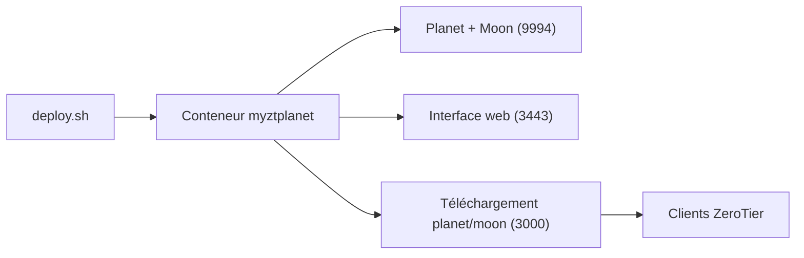

# xubiaolin/docker-zerotier-planet

> Deploys your own ZeroTier Planet with Docker, with an admin interface and file downloads.

## The problem
Depending on ZeroTier's official root servers for a private network, with no control over them.

## What it actually does
A `deploy.sh` script launches a container that serves as a Planet (root), a Moon, a controller with a web interface and a `planet` / `moon` file server. Clients replace their `planet` file to use this network. Data lives in `data/zerotier/`.

## How it is wired
Simplified diagram based on the sheet, no diagram provided.



## Trying it
```bash
git clone https://github.com/xubiaolin/docker-zerotier-planet.git
cd docker-zerotier-planet
./deploy.sh
docker ps --filter name=myztplanet
docker logs myztplanet
```

## Cost and gotchas
Requires a Linux server with a public IPv4 address and open ports. The interface is over HTTP, default credentials admin / password. Reinstalling erases `data/zerotier/`: backup is mandatory.

## What it is not
It is not a guarantee of direct connection between devices, nor a turnkey VPN. The README contains advertisements and the license is not declared.

## Alternatives
- WireGuard (script cited in the references): different protocol, not compatible with ZeroTier clients.

## For you
Worth watching: useful for a home or lab private network, but with no license and an administration you must secure yourself.
