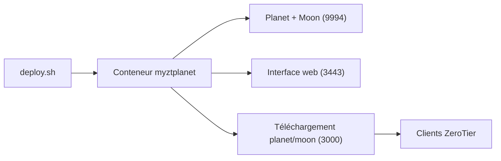

# xubiaolin/docker-zerotier-planet

> Déploie par Docker son propre Planet ZeroTier, avec interface d'administration et téléchargement des fichiers.

## Le problème
Dépendre des serveurs racines officiels de ZeroTier pour un réseau privé, sans contrôle sur eux.

## Ce que ça fait vraiment
Un script `deploy.sh` lance un conteneur qui sert de Planet (racine), de Moon, de contrôleur avec interface web et de serveur de fichiers `planet` / `moon`. Les clients remplacent leur fichier `planet` pour utiliser ce réseau. Les données vivent dans `data/zerotier/`.

## Comment c'est branché
Schéma simplifié d'après la fiche, sans diagramme fourni.



## Essayer
```bash
git clone https://github.com/xubiaolin/docker-zerotier-planet.git
cd docker-zerotier-planet
./deploy.sh
docker ps --filter name=myztplanet
docker logs myztplanet
```

## Coût et pièges
Il faut un serveur Linux avec IPv4 publique et ports ouverts. L'interface est en HTTP, identifiants par défaut admin / password. Réinstaller efface `data/zerotier/` : sauvegarde obligatoire.

## Ce que ce n'est pas
Ce n'est pas une garantie de connexion directe entre appareils, ni un VPN clé en main. Le README contient des publicités et la licence n'est pas déclarée.

## Alternatives
- WireGuard (script cité en références) : autre protocole, non compatible avec les clients ZeroTier.

## Pour toi
À surveiller : utile pour un réseau privé maison ou de laboratoire, mais sans licence et avec une administration à sécuriser toi-même.

