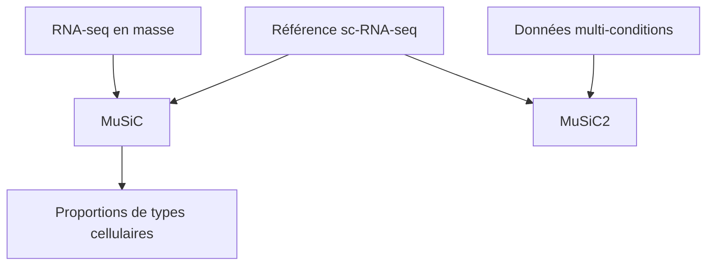

# xuranw/MuSiC

> R package for cell-type deconvolution of bulk RNA-seq data, using sc-RNA-seq references.

## The problem
Bulk RNA-seq data mixes several cell types, and you want to estimate their proportions.

## What it actually does
MuSiC estimates cell-type proportions from a multi-subject sc-RNA-seq reference. MuSiC2 adds an iterative algorithm for bulk data coming from several clinical conditions. Both are in a single R package, which accepts the `SingleCellExperiment` class. A development container for GitHub Codespaces with RStudio Server is provided.

## How it is wired
Simplified diagram based on the sheet, no diagram provided.



## Trying it
```r
install.packages('devtools')
devtools::install_github('xuranw/MuSiC')
library(MuSiC)
```

## Cost and gotchas
R (3.0 or later) and Bioconductor and CRAN packages are required, not Python: the "Python version" value above is the closest one in the list, the real need is an R version. Last push in March 2024, 109 open issues.

## What it is not
Not a general-purpose RNA-seq tool. The 2024 improvements concern comments and the container, not new methods.

## Alternatives
No alternative named in the README.

## For you
Keep an eye on it: published method (Nature Communications 2019) useful in bioinformatics, but the repository is no longer active.
