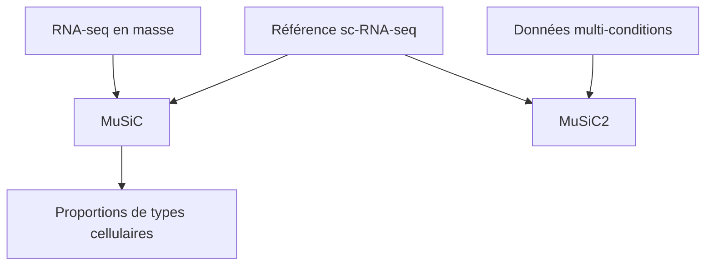

# xuranw/MuSiC

> Paquet R de déconvolution des types cellulaires dans des données RNA-seq en masse, à partir de références sc-RNA-seq.

## Le problème
Les données RNA-seq en masse mélangent plusieurs types de cellules, dont on veut estimer les proportions.

## Ce que ça fait vraiment
MuSiC estime les proportions de types cellulaires à partir d'une référence sc-RNA-seq multi-sujets. MuSiC2 ajoute un algorithme itératif pour les données en masse issues de plusieurs conditions cliniques. Les deux sont dans un seul paquet R, qui accepte la classe `SingleCellExperiment`. Un conteneur de développement pour GitHub Codespaces avec RStudio Server est fourni.

## Comment c'est branché
Schéma simplifié d'après la fiche, sans diagramme fourni.



## Essayer
```r
install.packages('devtools')
devtools::install_github('xuranw/MuSiC')
library(MuSiC)
```

## Coût et pièges
Il faut R (3.0 ou plus) et des paquets Bioconductor et CRAN, non Python : la valeur « version de Python » ci-dessus est la plus proche de la liste, le besoin réel est une version de R. Dernier push en mars 2024, 109 issues ouvertes.

## Ce que ce n'est pas
Pas un outil généraliste de RNA-seq. Les améliorations de 2024 portent sur les commentaires et le conteneur, pas sur de nouvelles méthodes.

## Alternatives
Aucune alternative nommée dans le README.

## Pour toi
Surveiller : méthode publiée (Nature Communications 2019) utile en bio-informatique, mais le dépôt n'est plus actif.

