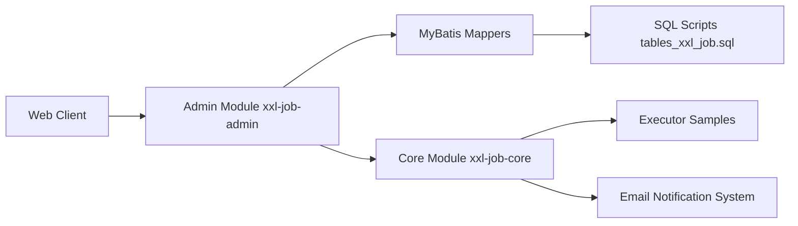

# xuxueli/xxl-job

> Java platform for distributed task scheduling, for teams that orchestrate jobs across several machines.

## The problem
Scheduled tasks (cron, dependencies, retries, alerts) scattered across several servers, with no control point and no high availability.

## What it actually does
A "scheduling center" (`xxl-job-admin`) with a web interface drives "executors" that register themselves. Triggers: cron, fixed interval, API, manual or parent-child; routing (round robin, consistent hash, failover, sharding), timeouts, retries, email alerts, live logs, GLUE scripts (Shell, Python, Node, PHP) and a built-in AI executor (spring-ai, ollama, dify). Consistency relies on a database lock. Interface in Chinese or English.

## How it is wired

## Trying it
No command in the README: it points to the documentation in Chinese and English.

## Cost and gotchas
Free. The center needs a database (the SQL script is provided) and a JDK. GPL-3.0 license, README mostly in Chinese, and a long list of user companies.

## What it is not
Not a data pipeline orchestrator (no dataset dependency graphs): a job scheduler, rather Java-oriented.

## Alternatives
No alternative cited in the README.

## For you
Ignore: if you work in Python, Airflow, Prefect or Kestra cover pipeline orchestration better; this one is mainly worthwhile for Java teams.
