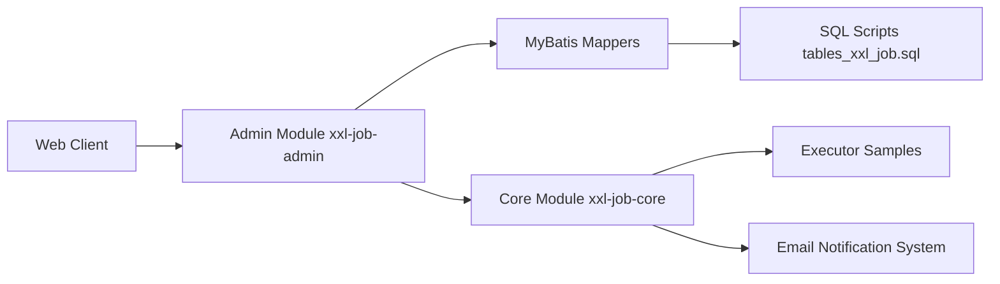

# xuxueli/xxl-job

> Plateforme Java de planification de tâches distribuées, pour équipes qui orchestrent des jobs sur plusieurs machines.

## Le problème
Des tâches planifiées (cron, dépendances, nouvelle tentative, alertes) éparpillées sur plusieurs serveurs, sans point de contrôle ni haute disponibilité.

## Ce que ça fait vraiment
Un « centre de planification » (`xxl-job-admin`) avec interface web pilote des « exécuteurs » qui s'enregistrent d'eux-mêmes. Déclencheurs cron, intervalle fixe, API, manuel ou parent-enfant ; routage (rotation, hash cohérent, bascule, fragmentation), délais d'attente, reprises, alerte par e-mail, journaux en direct, scripts GLUE (Shell, Python, Node, PHP) et exécuteur d'IA intégré (spring-ai, ollama, dify). La cohérence repose sur un verrou en base de données. Interface en chinois ou en anglais.

## Comment c'est branché

## Essayer
Aucune commande dans le README : renvoie vers la documentation en chinois et en anglais.

## Coût et pièges
Gratuit. Le centre a besoin d'une base de données (le script SQL est fourni) et d'un JDK. Licence GPL-3.0, README surtout en chinois, et une longue liste de sociétés utilisatrices.

## Ce que ce n'est pas
Pas un orchestrateur de pipelines de données (pas de graphes de dépendances de datasets) : un planificateur de jobs, plutôt orienté Java.

## Alternatives
Aucune alternative citée dans le README.

## Pour toi
À ignorer : si tu es en Python, Airflow, Prefect ou Kestra couvrent mieux l'orchestration de pipelines ; celui-ci vaut surtout pour des équipes Java.

