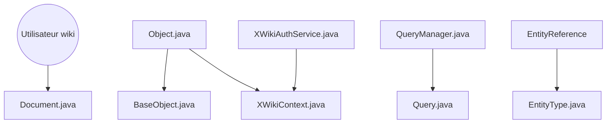

# xwiki/xwiki-platform

> Generic wiki platform in Java, serving as a foundation for applications built on top of it.

## The problem
Building a collaborative application based on pages and structured data forces you to rewrite storage, access rights and queries.

## What it actually does
The code exposes a document and object API, an entity model (document references), a query service (Query, QueryManager, HQL) and an authentication and rights foundation. The very short README points to the developer, administrator and user guides. Only some modules are described; the rest of the platform is not documented here.

## How it is wired


## Trying it
```bash
# Aucune commande documentée dans le README : voir les instructions
# de téléchargement et d'installation du site du projet.
```

## Cost and gotchas
Free. Issue tracking is not on GitHub (separate tool). Java and an application server are needed in practice, not specified in the README.

## What it is not
Not a data or AI tool. Not a simple turnkey wiki: it is an application development platform. The README describes almost nothing about how it works.

## Alternatives
No alternative named in the README.

## For you
Ignore: general-purpose Java platform unrelated to a data, AI or MLOps workflow, and under LGPL.
