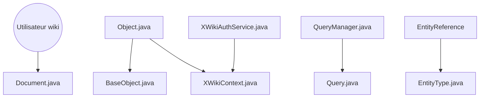

# xwiki/xwiki-platform

> Plateforme wiki générique en Java, qui sert de socle à des applications construites dessus.

## Le problème
Construire une application collaborative à base de pages et de données structurées oblige à réécrire stockage, droits d'accès et requêtes.

## Ce que ça fait vraiment
Le code expose une API de documents et d'objets, un modèle d'entités (références de documents), un service de requêtes (Query, QueryManager, HQL) et un socle d'authentification et de droits. Le README, très court, renvoie aux guides développeur, administrateur et utilisateur. Seuls certains modules sont décrits ; le reste de la plateforme n'est pas documenté ici.

## Comment c'est branché


## Essayer
```bash
# Aucune commande documentée dans le README : voir les instructions
# de téléchargement et d'installation du site du projet.
```

## Coût et pièges
Gratuit. Le suivi des tickets n'est pas sur GitHub (outil à part). Java et un serveur d'applications sont nécessaires en pratique, non précisé dans le README.

## Ce que ce n'est pas
Pas un outil de données ni d'IA. Pas un simple wiki clés en main : c'est une plateforme de développement d'applications. Le README ne décrit presque rien de son fonctionnement.

## Alternatives
Aucune alternative nommée dans le README.

## Pour toi
À ignorer : plateforme Java généraliste sans lien avec un flux data, IA ou MLOps, et sous LGPL.

