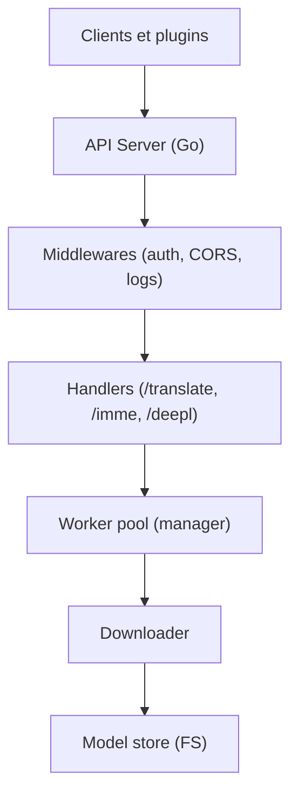

# xxnuo/MTranServer

> Offline, GPU-free translation server compatible with browser and editor translation plugins.

## The problem
Online translation APIs cost money, send the text elsewhere, and conventional translation models are heavy.

## What it actually does
A Go server with an optional web interface that downloads quantized ONNX models per language pair on first use, then runs them on CPU through a worker pool. It exposes interfaces compatible with Immersive Translate, Kiss, DeepL, DeepLX, Google and hcfy. The README reports 86 requests per second for English to Chinese (6-thread CPU).

## How it is wired


## Trying it
```bash
npx mtranserver@latest
npm i -g mtranserver@latest
docker pull xxnuo/mtranserver:latest
docker compose up -d
```

## Cost and gotchas
Free. First use of each language pair: download and preparation (up to more than a minute), so a connection is needed before offline mode. About 350 to 480 MiB of memory per tested direction. Also back up the configuration folder in addition to the models.

## What it is not
It is not verified-quality translation: the README says the output is good for grasping the gist and may contain errors. The quality of v5 has not been evaluated. The browser plugin is still to be done.

## Alternatives
NLLB, LibreTranslate and OPUS-MT, compared in the README as more memory-hungry or slower.

## For you
Adopt it to translate locally without a GPU or API key, with APIs already compatible with DeepL and Google; check the quality on your language pair.
