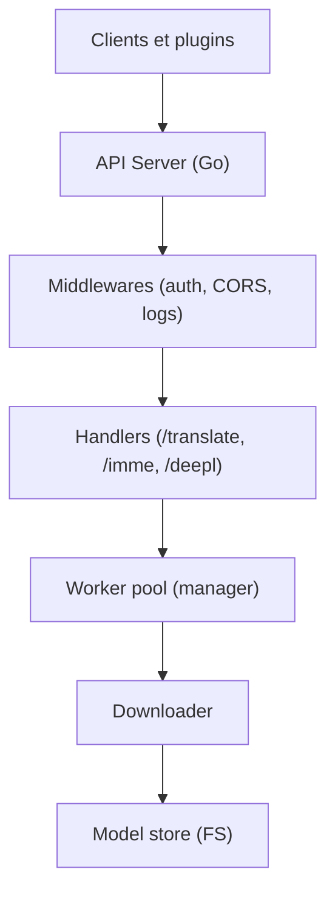

# xxnuo/MTranServer

> Serveur de traduction hors ligne, sans GPU, compatible avec les plugins de traduction de navigateur et d'éditeur.

## Le problème
Les API de traduction en ligne coûtent, envoient le texte à l'extérieur, et les modèles de traduction classiques sont lourds.

## Ce que ça fait vraiment
Serveur Go avec interface web optionnelle, qui télécharge au premier usage des modèles ONNX quantifiés par paire de langues, puis les exécute sur CPU via un pool de workers. Il expose des interfaces compatibles Immersive Translate, Kiss, DeepL, DeepLX, Google et hcfy. Le README donne 86 requêtes par seconde en anglais vers chinois (CPU 6 threads).

## Comment c'est branché


## Essayer
```bash
npx mtranserver@latest
npm i -g mtranserver@latest
docker pull xxnuo/mtranserver:latest
docker compose up -d
```

## Coût et pièges
Gratuit. Premier usage de chaque paire de langues : téléchargement et préparation (jusqu'à plus d'une minute), donc connexion nécessaire avant le mode hors ligne. Environ 350 à 480 Mio de mémoire par direction testée. Sauvegarder aussi le dossier de configuration en plus des modèles.

## Ce que ce n'est pas
Ce n'est pas une traduction de qualité vérifiée : le README dit que le résultat est bon pour comprendre l'essentiel et peut contenir des erreurs. La qualité du v5 n'est pas évaluée. Le plugin navigateur est encore à faire.

## Alternatives
NLLB, LibreTranslate et OPUS-MT, comparés dans le README comme plus gourmands en mémoire ou plus lents.

## Pour toi
À adopter pour traduire en local sans GPU ni clé d'API, avec des API déjà compatibles DeepL et Google ; vérifier la qualité sur ta paire de langues.

