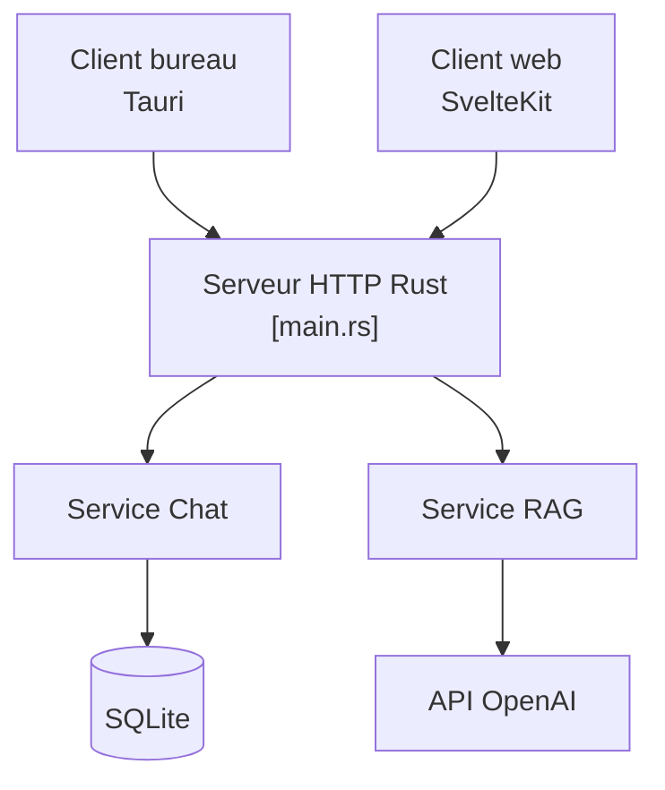

# xxnuo/open-coreui

> Lightweight Rust version of Open WebUI, as a desktop client or server, to chat with models.

## The problem
Open WebUI requires Docker, Python, PostgreSQL and Redis, and uses a lot of memory for a simple chat interface.

## What it actually does
Rewritten fork of Open WebUI v0.6.32: the original frontend, a Rust backend and a single executable. Two independent clients: a desktop application (Tauri) or a command-line server with browser access. The README states that only basic chat is implemented for now.

## How it is wired


## Trying it
```bash
chmod +x open-coreui-*
./open-coreui-*
```
Then open the displayed address, usually `http://localhost:8168`. On macOS, in case of an "app is damaged" error: `sudo xattr -d com.apple.quarantine "/Applications/Open CoreUI Desktop.app"`.

## Cost and gotchas
Free, but no license declared even though the code derives from Open WebUI. The diagram also mentions a code-execution sandbox.

## What it is not
It is not an official or complete version: "early development". It is not a model, you need a provider behind it.

## Alternatives
- Open WebUI: the original, more complete but heavier.

## For you
Worth watching: handy for a lightweight local chat without Docker, but too young and without a clear license to rely on.
