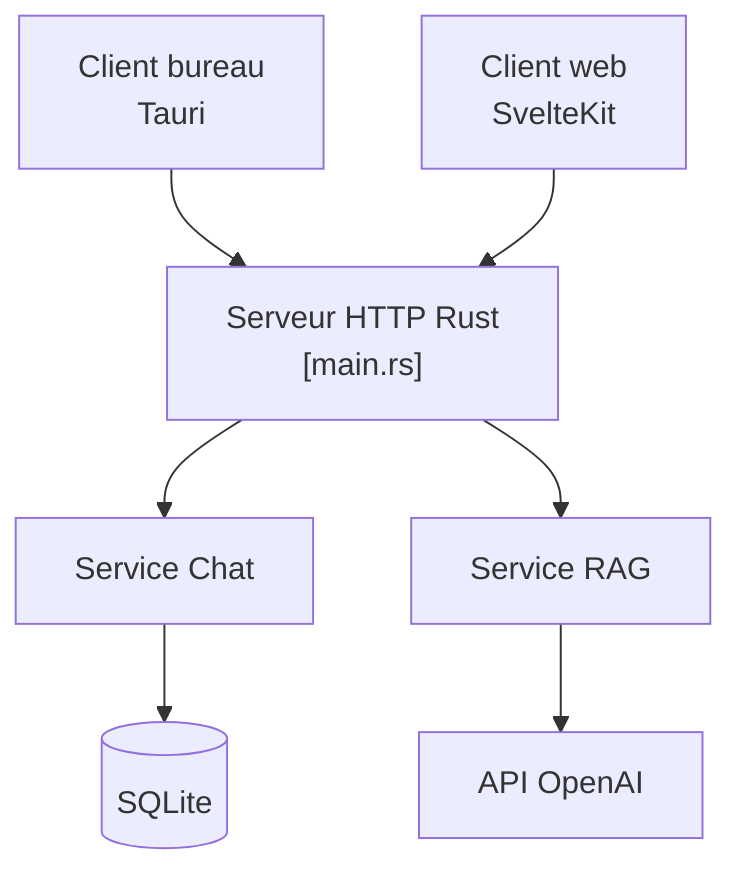

# xxnuo/open-coreui

> Version allégée en Rust d'Open WebUI, en client de bureau ou serveur, pour discuter avec des modèles.

## Le problème
Open WebUI demande Docker, Python, PostgreSQL et Redis, et consomme beaucoup de mémoire pour une simple interface de chat.

## Ce que ça fait vraiment
Fork réécrit d'Open WebUI v0.6.32 : le frontend original, un backend Rust et un exécutable unique. Deux clients indépendants : application de bureau (Tauri) ou serveur en ligne de commande avec accès par navigateur. Le README précise que seul le chat de base est implémenté pour l'instant.

## Comment c'est branché


## Essayer
```bash
chmod +x open-coreui-*
./open-coreui-*
```
Puis ouvrir l'adresse affichée, en général `http://localhost:8168`. Sur macOS, en cas d'erreur « app is damaged » : `sudo xattr -d com.apple.quarantine "/Applications/Open CoreUI Desktop.app"`.

## Coût et pièges
Gratuit, mais aucune licence déclarée alors que le code dérive d'Open WebUI. Le diagramme évoque aussi un bac à sable d'exécution de code.

## Ce que ce n'est pas
Ce n'est pas une version officielle ni complète : « early development ». Ce n'est pas un modèle, il faut un fournisseur derrière.

## Alternatives
- Open WebUI : l'original, plus complet mais plus lourd.

## Pour toi
À surveiller : pratique pour un chat local léger sans Docker, mais trop jeune et sans licence claire pour t'y fier.

