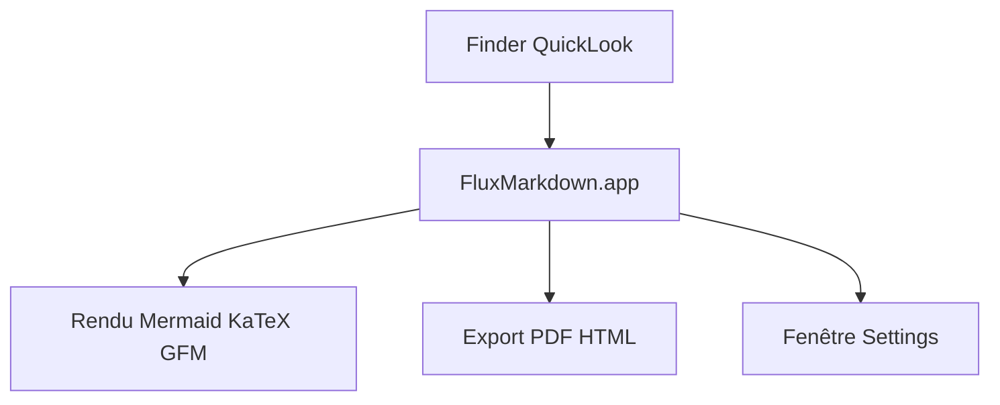

# xykong/flux-markdown

> macOS QuickLook extension that previews Markdown in the Finder, with diagrams and formulas.

## The problem
In the Finder, pressing Space shows only plain text for Markdown files.

## What it actually does
A preview with Mermaid, KaTeX, GFM, Vega charts and Graphviz, table of contents, YAML front matter and code highlighting. Export to PDF or HTML, zoom, reading position memory and three themes. The `.md`, `.mdx`, `.qmd` and other formats are recognized.

## How it is wired
Simplified diagram based on the sheet, no diagram provided.



## Trying it
```bash
brew install --cask xykong/tap/flux-markdown
git clone https://github.com/xykong/flux-markdown.git
cd flux-markdown
make install
```

## Cost and gotchas
Free. Homebrew may warn that the third-party tap is not trusted: the README advises `brew trust --cask xykong/tap/flux-markdown`.

## What it is not
It is not a Markdown editor: it is a preview only. It only works on macOS. The comparison table is the author's own, based on the competitors' READMEs.

## Alternatives
QLMarkdown, qlmarkdown and PreviewMarkdown, cited in the comparison table.

## For you
Ignore: a pleasant macOS utility for reading notes or docs, but of no consequence for a data, AI or MLOps profile.
