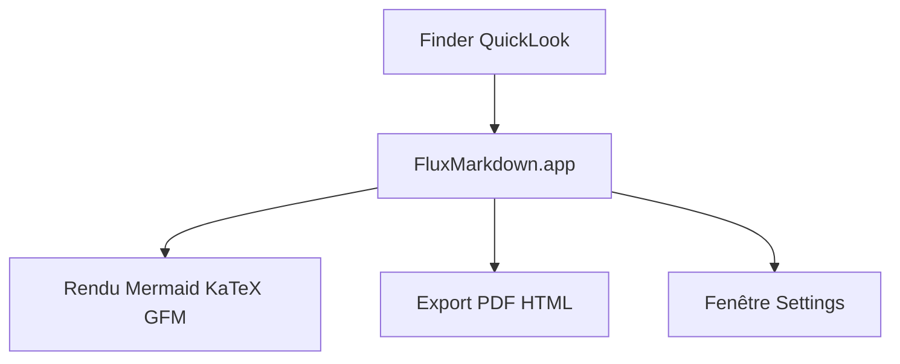

# xykong/flux-markdown

> Extension QuickLook macOS qui prévisualise le Markdown dans le Finder, avec diagrammes et formules.

## Le problème
Dans le Finder, la touche Espace n'affiche qu'un texte brut pour les fichiers Markdown.

## Ce que ça fait vraiment
Une prévisualisation avec Mermaid, KaTeX, GFM, graphiques Vega et Graphviz, table des matières, front matter YAML et coloration de code. Export en PDF ou HTML, zoom, mémoire de la position de lecture et trois thèmes. Les formats `.md`, `.mdx`, `.qmd` et autres sont reconnus.

## Comment c'est branché
Schéma simplifié d'après la fiche, sans diagramme fourni.



## Essayer
```bash
brew install --cask xykong/tap/flux-markdown
git clone https://github.com/xykong/flux-markdown.git
cd flux-markdown
make install
```

## Coût et pièges
Gratuit. Homebrew peut avertir que le tap tiers n'est pas de confiance : le README conseille `brew trust --cask xykong/tap/flux-markdown`.

## Ce que ce n'est pas
Ce n'est pas un éditeur Markdown : c'est un aperçu seulement. Il ne fonctionne que sous macOS. Le tableau de comparaison est celui de l'auteur, fondé sur les README des concurrents.

## Alternatives
QLMarkdown, qlmarkdown et PreviewMarkdown, cités dans le tableau comparatif.

## Pour toi
À ignorer : utilitaire macOS agréable pour lire des notes ou des docs, mais sans enjeu pour un profil data, IA ou MLOps.

