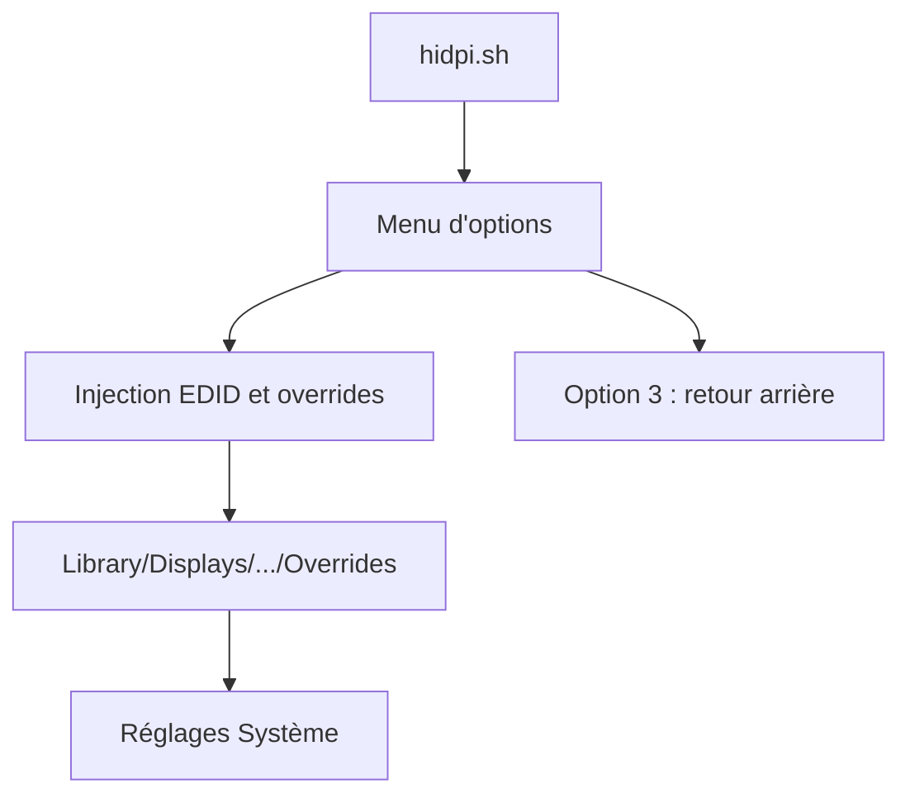

# xzhih/one-key-hidpi

> macOS script that simulates HiDPI mode on a non-Retina display, for Mac users.

## The problem
On an external display that is not Retina, macOS offers neither sharp scaling nor adjustable "native" resolutions.

## What it actually does
The script injects a display configuration to enable simulated HiDPI, with an option that adds a modified EDID against certain wake-up problems. A rollback procedure exists: option 3 of the script, or from recovery mode by deleting the overrides folder.

## How it is wired
Simplified diagram based on the sheet, no diagram provided.



## Trying it
```bash
bash -c "$(curl -fsSL https://raw.githubusercontent.com/xzhih/one-key-hidpi/master/hidpi.sh)"
```

## Cost and gotchas
Free, but no license declared and last push in April 2025. Running a remote script via curl modifies system files; plan the recovery procedure before launching.

## What it is not
It is not true high resolution: the README warns that the boot logo may remain blurry, since the resolution is simulated.

## Alternatives
- syscl/Enable-HiDPI-OSX: project cited as a source of inspiration.

## For you
Ignore: macOS display tweak unrelated to a data, AI or MLOps profile, and with no license or recent maintenance.
