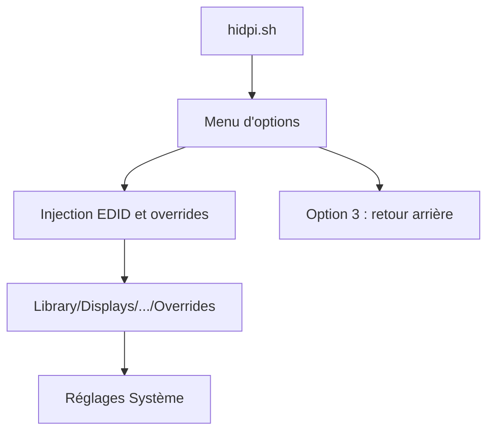

# xzhih/one-key-hidpi

> Script macOS qui simule le mode HiDPI sur un écran non Retina, pour utilisateurs de Mac.

## Le problème
Sur un écran externe qui n'est pas Retina, macOS n'offre pas de mise à l'échelle nette ni de résolutions « natives » ajustables.

## Ce que ça fait vraiment
Le script injecte une configuration d'affichage pour activer le HiDPI simulé, avec une option qui ajoute un EDID modifié contre certains problèmes de réveil. Une procédure de retour arrière existe : option 3 du script, ou depuis le mode de récupération en supprimant le dossier d'overrides.

## Comment c'est branché
Schéma simplifié d'après la fiche, sans diagramme fourni.



## Essayer
```bash
bash -c "$(curl -fsSL https://raw.githubusercontent.com/xzhih/one-key-hidpi/master/hidpi.sh)"
```

## Coût et pièges
Gratuit, mais aucune licence déclarée et dernier push en avril 2025. Exécuter un script distant par curl modifie des fichiers système ; prévois la procédure de récupération avant de lancer.

## Ce que ce n'est pas
Ce n'est pas une vraie haute résolution : le README prévient que le logo de démarrage peut rester flou, la résolution étant simulée.

## Alternatives
- syscl/Enable-HiDPI-OSX : projet cité comme source d'inspiration.

## Pour toi
Ignorer : réglage d'écran macOS sans lien avec un profil data, IA ou MLOps, et sans licence ni suivi récent.

