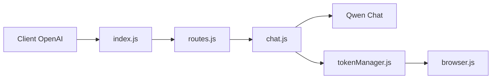

# y13sint/FreeQwenApi

> Local OpenAI-compatible proxy that exploits a Qwen Chat web account through an automated browser.

## The problem
Use Qwen models in OpenAI-compatible tools without an official API key.

## What it actually does
An Express server listens on `localhost:3264/api`: chat completions (with tools emulated by prompt), image and video generation, file upload, model list. It drives Chromium to authenticate to Qwen Chat, stores tokens in `session/` and rotates between accounts when a limit is hit. README in Russian, marked with a t.me/forgetmeai watermark.

## How it is wired


## Trying it
```bash
git clone https://github.com/ForgetMeAI/FreeQwenApi
cd FreeQwenApi
npm install
npm run auth
SKIP_ACCOUNT_MENU=true npm start
```

## Cost and gotchas
Free but a Qwen Chat account is required; tokens expire and account limits apply. Secrets in `session/` must not be committed.

## What it is not
Neither a local model nor Alibaba's official API: an unofficial proxy, fragile if Qwen changes its API, and probably against the terms of use (not verified). No license.

## Alternatives
No alternative cited in the README.

## For you
Ignore in production: fragile, unlicensed and bypassing the official API; go through the paid Qwen API instead.
