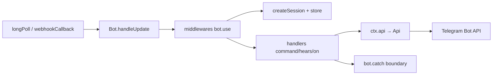

# yagop/node-telegram-bot-api

> TypeScript library for Telegram bots, rewritten as v2, portable from servers to serverless.

## The problem
A Telegram bot written for Node does not run as-is on Cloudflare Workers or Vercel, and conversation state disappears on restart.

## What it actually does
Exposes `Api`, which mirrors the Telegram API method by method, and `Bot`, with koa-style middlewares where `on`, `command` and `hears` are filters of the same chain.
Web-standard webhook `(Request) => Promise`, plus Next.js, Express and Node server adapters.
Opt-in sessions with a mandatory store (memory, file, SQLite, SQL, Redis): nothing lives in process memory between two updates.
Reply and button-press tracking is stored as data, not as a promise, so it survives a restart.

## How it is wired


## Trying it
```sh
npm install node-telegram-bot-api
DEBUG="node-telegram-bot-api:*" node app.js
bun run check
bun run build
```

## Cost and gotchas
Free; you need a `BOT_TOKEN` obtained from Telegram. The webhook `secret_token` is the only thing that authenticates the caller — payloads are not signed. The `/bun` stores import Bun built-ins and do not resolve under Node or edge.

## What it is not
Not v1 compatible: v2 is a complete rewrite, with a migration guide in the changelog. Reply-tracking tables do not expire on their own, you need a TTL or a capped `replyTracking`. `debug` tracing is Node-only, inert on edge.

## Alternatives
No competing library named in the README.

## For you
Outside the scope of pure data work, but a good design reference: explicit stores, serialized state, serverless portability.
