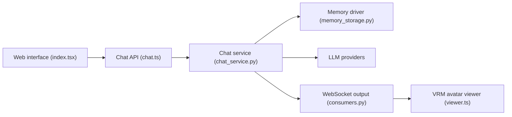

# yakami129/VirtualWife

> Virtual character chatbot with a VRM avatar, memory and voice, deployable with Docker.

## The problem
Chatting with an animated character that keeps a personality and a memory, without assembling the LLM, voice and avatar yourself.

## What it actually does
A Django backend and a web client display a VRM model. You choose a role and an LLM (OpenAI or Ollama), responses are streamed and drive voice and expressions. Long-term memory can use local storage, Milvus or Zep. A Bilibili live client is also included. The README calls itself "in incubation".

## How it is wired

The front-to-back link is not verified in the architecture provided.

## Trying it
```bash
cd installer
mv env_example .env
cd linux
sh start.sh
# puis http://localhost/
```

## Cost and gotchas
An OPENAI_API_KEY key (or local Ollama). Behind Docker, access to Ollama goes through `http://host.docker.internal:11434`. First start: about 5 minutes of images to download.

## What it is not
Not an agent framework. Documentation in Chinese. Last push in October 2024: no guarantee of a follow-up.

## Alternatives
No alternative named in the README.

## For you
Ignore for a data/MLOps profile: a consumer-oriented virtual companion project, run by a single person and with no activity since late 2024.
