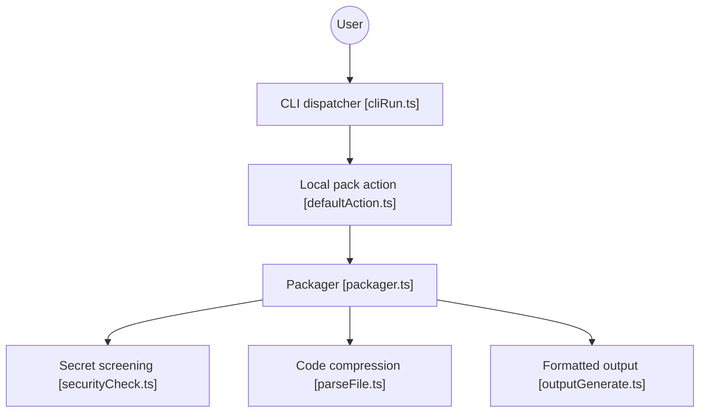

# yamadashy/repomix

> Command-line tool that condenses a repository into a single LLM-readable file.

## The problem
Giving an AI assistant a whole source code base means copying files one by one, with no token counting.

## What it actually does
Packs the repository (local or remote) into XML, Markdown, JSON or text, respecting `.gitignore`, with token counting, secret detection via Secretlint and compression via Tree-sitter. It also offers an MCP server, a browser extension, a website, a watch mode and Claude skill generation.

## How it is wired


## Trying it
```bash
npx repomix@latest
repomix --compress
repomix --remote yamadashy/repomix
repomix --include "src/**/*.ts" --ignore "**/*.test.ts"
repomix --stdout | llm "Please explain what this code does."
```

## Cost and gotchas
Free. The generated file may exceed the model's window: use `--compress` or `--token-budget`. A remote repository's configuration is not loaded by default.

## What it is not
Not an analysis tool: it prepares context without understanding the code. Secret detection only covers known formats. README truncated at the end of the document.

## Alternatives
- Gitingest: better suited to the Python ecosystem according to the README.

## For you
To adopt: one command to prepare a repository for an LLM, with compression and secret checks.
