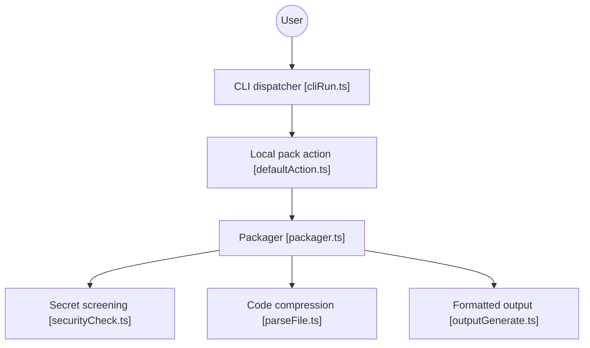

# yamadashy/repomix

> Outil en ligne de commande qui condense un dépôt en un seul fichier lisible par un LLM.

## Le problème
Donner à un assistant IA tout un code source oblige à copier des fichiers un par un, sans compter les jetons.

## Ce que ça fait vraiment
Assemble le dépôt (local ou distant) en XML, Markdown, JSON ou texte, en respectant `.gitignore`, avec comptage de jetons, détection de secrets par Secretlint et compression par Tree-sitter. Offre aussi un serveur MCP, une extension de navigateur, un site web, un mode watch et la génération de skills Claude.

## Comment c'est branché


## Essayer
```bash
npx repomix@latest
repomix --compress
repomix --remote yamadashy/repomix
repomix --include "src/**/*.ts" --ignore "**/*.test.ts"
repomix --stdout | llm "Please explain what this code does."
```

## Coût et pièges
Gratuit. Le fichier généré peut dépasser la fenêtre du modèle : utiliser `--compress` ou `--token-budget`. La configuration d'un dépôt distant n'est pas chargée par défaut.

## Ce que ce n'est pas
Pas un outil d'analyse : il prépare le contexte, sans comprendre le code. La détection de secrets ne couvre que les formats connus. README tronqué en fin de document.

## Alternatives
- Gitingest : mieux adapté à l'écosystème Python selon le README.

## Pour toi
À adopter : une commande pour préparer un dépôt à passer dans un LLM, avec compression et contrôle de secrets.

