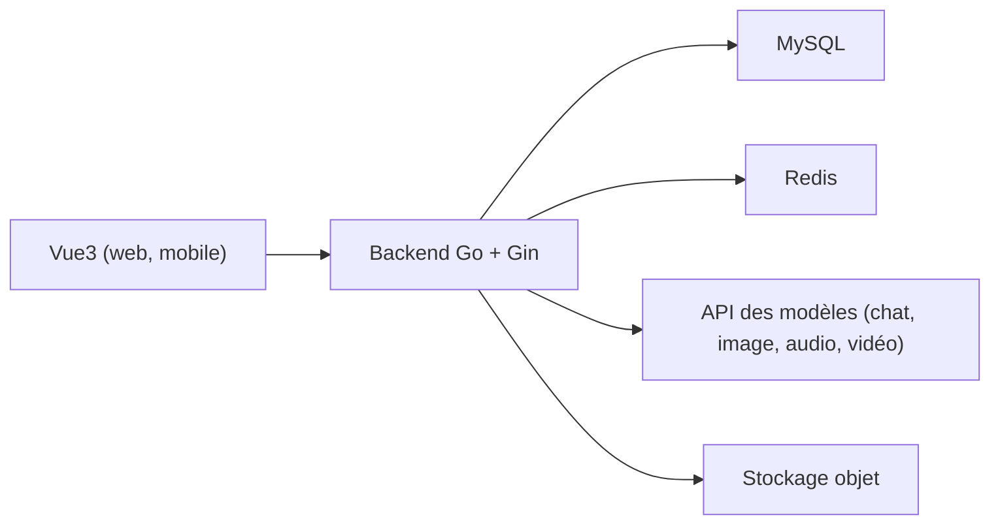

# yangjian102621/geekai

> All-in-one AI creation platform (chat, image, music, video) with accounts and billing.

## The problem
Setting up a sellable multimodal AI creation service requires bringing together models, user accounts, payment and administration.

## What it actually does
A Go application (Gin), MySQL and Redis, with a Vue 3 front end. It aggregates ChatGPT, Claude, MidJourney, DALL-E, Suno, Luma and others through their APIs, and adds sign-up, points, subscriptions, statistics and an admin area. Storage goes to Qiniu, OSS, Minio and others.

## How it is wired

Simplified diagram based on the sheet, no diagram provided.

## Trying it
```bash
docker-compose up -d
```

## Cost and gotchas
API keys for each provider (MidJourney, Suno, etc.) are at your expense. The README states that private deployments are not updated automatically. Documentation and README are in Chinese.

## What it is not
It is not a model: it resells access to third-party services. The README's figures (80% faster response) are unsupported.

## Alternatives
No alternative named in the README.

## For you
Ignore: it is a product layer that depends on paid APIs, with no technical contribution for a data or MLOps profile.
