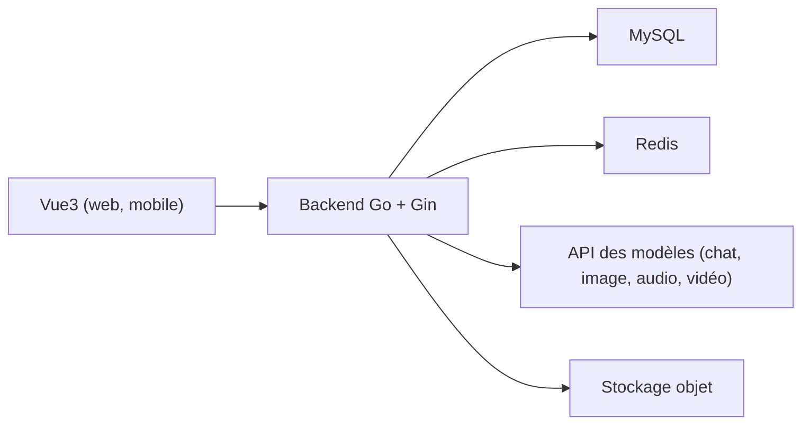

# yangjian102621/geekai

> Plateforme de création IA tout-en-un (chat, image, musique, vidéo) avec comptes et facturation.

## Le problème
Monter un service de création IA multimodal vendable demande de réunir modèles, comptes utilisateurs, paiement et administration.

## Ce que ça fait vraiment
Application Go (Gin), MySQL et Redis, avec front Vue 3. Elle agrège ChatGPT, Claude, MidJourney, DALL-E, Suno, Luma et d'autres via leurs API, et ajoute inscription, points, abonnements, statistiques et espace d'administration. Le stockage va vers Qiniu, OSS, Minio et d'autres.

## Comment c'est branché

Schéma simplifié d'après la fiche, sans diagramme fourni.

## Essayer
```bash
docker-compose up -d
```

## Coût et pièges
Les clés d'API de chaque fournisseur (MidJourney, Suno, etc.) sont à ta charge. Le README précise que le déploiement privé n'est pas mis à jour automatiquement. Documentation et README en chinois.

## Ce que ce n'est pas
Ce n'est pas un modèle : il revend l'accès à des services tiers. Les chiffres du README (réponse plus rapide de 80 %) ne sont pas étayés.

## Alternatives
Aucune alternative nommée dans le README.

## Pour toi
À ignorer : c'est une couche produit qui dépend d'API payantes, sans apport technique pour un profil data ou MLOps.

