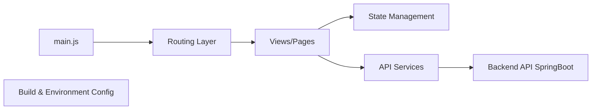

# yangzongzhuan/RuoYi-Vue3

> Vue 3 front end of a Java SpringBoot administration framework, for business management teams.

## The problem
Building administration consoles (users, roles, menus) takes repetitive time.

## What it actually does
A Vue 3 + Element Plus + Vite application, meant to be plugged into the SpringBoot back end (RuoYi-Vue or RuoYi-Vue-fast repositories). Features: users, departments, roles, menus, dictionaries, scheduled tasks, logs, code generation, server and cache monitoring. README in Chinese; the diagram mentions Vuex whereas the README table indicates Pinia.

## How it is wired


## Trying it
```bash
git clone https://github.com/yangzongzhuan/RuoYi-Vue3.git
cd RuoYi-Vue3
yarn --registry=https://registry.npmmirror.com
yarn dev
```

## Cost and gotchas
Needs the separate back end to be useful. Demo credentials `admin/admin123` in the README. Cloud advertising and QQ groups in the README.

## What it is not
Not a complete product: only the front end.

## Alternatives
RuoYi-Vue2 and RuoYi-Vue3-TypeScript, variants of the same project.

## For you
Ignore: a Java/Vue administration framework unrelated to data/AI/MLOps.
