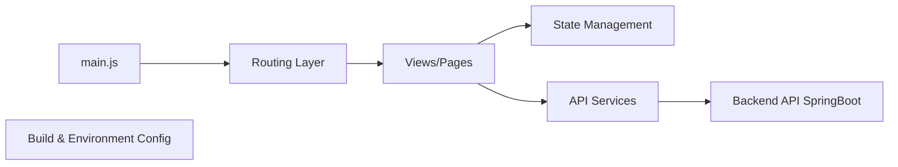

# yangzongzhuan/RuoYi-Vue3

> Front-end Vue 3 d'un cadre d'administration Java SpringBoot, pour équipes de gestion d'entreprise.

## Le problème
Construire des consoles d'administration (utilisateurs, rôles, menus) coûte du temps répétitif.

## Ce que ça fait vraiment
Application Vue 3 + Element Plus + Vite, à brancher sur le back-end SpringBoot (dépôts RuoYi-Vue ou RuoYi-Vue-fast). Fonctions : utilisateurs, départements, rôles, menus, dictionnaires, tâches planifiées, journaux, génération de code, surveillance serveur et cache. README en chinois ; le diagramme parle de Vuex alors que le tableau du README indique Pinia.

## Comment c'est branché


## Essayer
```bash
git clone https://github.com/yangzongzhuan/RuoYi-Vue3.git
cd RuoYi-Vue3
yarn --registry=https://registry.npmmirror.com
yarn dev
```

## Coût et pièges
Nécessite le back-end séparé pour être utile. Identifiants de démo `admin/admin123` au README. Publicité de cloud et groupes QQ dans le README.

## Ce que ce n'est pas
Pas un produit complet : seulement le front-end.

## Alternatives
RuoYi-Vue2 et RuoYi-Vue3-TypeScript, déclinaisons du même projet.

## Pour toi
À ignorer : cadre d'administration Java/Vue sans lien avec data/IA/MLOps.

