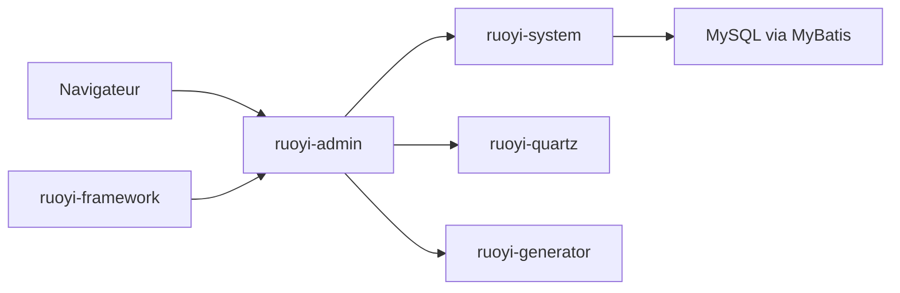

# yangzongzhuan/RuoYi

> Java Spring Boot framework for quickly building administration back offices, README in Chinese.

## The problem
Every enterprise application reimplements users, roles, menus, logs and scheduled tasks.

## What it actually does
Spring Boot administration platform as a multi-module monolith: management of users, departments, roles and permissions, dictionaries, logs, online users, Quartz tasks, code generation (Velocity), Swagger API documentation, server and cache monitoring. MyBatis persistence, Shiro security, Thymeleaf interface (H+ theme). Spring Boot 2, 3 and 4 branches.

## How it is wired

## Trying it
No documented command. The README points to the demo (ruoyi.vip, admin account) and to the online documentation.

## Cost and gotchas
Free. Current version 4.8.3; a relational database is required (deduced from the architecture).

## What it is not
Not a data analysis tool. The demo and discussion links are in Chinese.

## Alternatives
- RuoYi-Vue (separate front/back version) and RuoYi-Cloud (microservices), cited in the README.

## For you
Ignore: Java management application skeleton, outside the data/AI scope.
