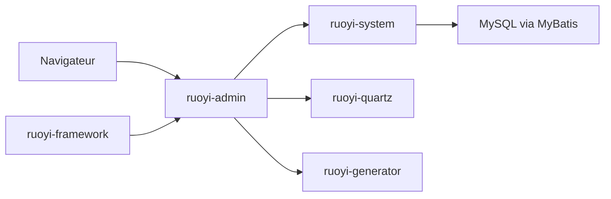

# yangzongzhuan/RuoYi

> Framework Java Spring Boot pour construire vite des back-offices d'administration, README en chinois.

## Le problème
Chaque application d'entreprise réimplémente utilisateurs, rôles, menus, journaux et tâches planifiées.

## Ce que ça fait vraiment
Plateforme d'administration Spring Boot en monolithe multi-modules : gestion des utilisateurs, départements, rôles et permissions, dictionnaires, journaux, utilisateurs en ligne, tâches Quartz, génération de code (Velocity), documentation d'API Swagger, supervision serveur et cache. Persistance MyBatis, sécurité Shiro, interface Thymeleaf (thème H+). Branches Spring Boot 2, 3 et 4.

## Comment c'est branché

## Essayer
Aucune commande documentée. Le README renvoie à la démo (ruoyi.vip, compte admin) et à la documentation en ligne.

## Coût et pièges
Gratuit. Version courante 4.8.3 ; une base relationnelle est nécessaire (déduit de l'architecture).

## Ce que ce n'est pas
Pas un outil d'analyse de données. Les liens de démo et de discussion sont en chinois.

## Alternatives
- RuoYi-Vue (version front/back séparés) et RuoYi-Cloud (microservices), cités dans le README.

## Pour toi
À ignorer : squelette d'application Java de gestion, hors du périmètre data/IA.

