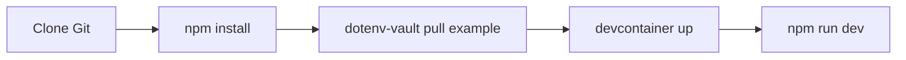

# yapms/yapms

> Development environment for YAPms, a web application; the README only describes the setup.

## The problem
Not documented: the README does not say what problem YAPms solves.

## What it actually does
Not documented. The README only describes setting up the development workstation: a VS Code devcontainer, or a direct install with Node.js, Go, Docker and, optionally, pngquant. It states it was tested on NixOS.

## How it is wired
Simplified diagram based on the sheet, no diagram provided.



## Trying it
```bash
npm install
npx dotenv-vault pull example
npx devcontainer up --workspace-folder .
npm run dev
```

## Cost and gotchas
Docker, Node.js and Go are required. The `dotenv-vault pull example` secret assumes access to this variables vault, which is not explained.

## What it is not
It is not product documentation: we do not know what the tool does. The AGPL-3.0 license requires sharing modifications served over a network.

## Alternatives
No alternative named in the README.

## For you
Ignore: the README does not explain the project's usefulness, so it is impossible to tie it to a data or MLOps need.
