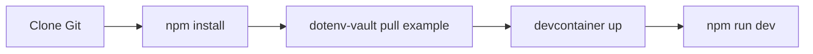

# yapms/yapms

> Environnement de développement de YAPms, une application web ; le README décrit seulement l'installation.

## Le problème
Non documenté : le README ne dit pas quel problème YAPms résout.

## Ce que ça fait vraiment
Non documenté. Le README ne décrit que la mise en place du poste de développement : un devcontainer VS Code, ou une installation directe avec Node.js, Go, Docker et, en option, pngquant. Il indique avoir été testé sous NixOS.

## Comment c'est branché
Schéma simplifié d'après la fiche, sans diagramme fourni.



## Essayer
```bash
npm install
npx dotenv-vault pull example
npx devcontainer up --workspace-folder .
npm run dev
```

## Coût et pièges
Docker, Node.js et Go sont nécessaires. Le secret `dotenv-vault pull example` suppose un accès à ce coffre de variables, non expliqué.

## Ce que ce n'est pas
Ce n'est pas une documentation de produit : on ne sait pas ce que fait l'outil. La licence AGPL-3.0 impose de partager les modifications servies en réseau.

## Alternatives
Aucune alternative nommée dans le README.

## Pour toi
À ignorer : le README n'explique pas l'utilité du projet, donc impossible de le relier à un besoin data ou MLOps.

