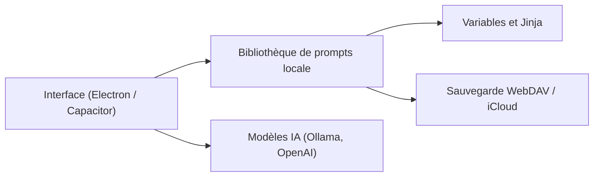

# yarin-zhang/AI-Gist

> Local prompt manager with variables and Jinja templates, for Windows, macOS, Linux, Android and iOS.

## The problem
Useful prompts are scattered across notes and histories, with no variables or versions to reuse them.

## What it actually does
AI Gist organizes prompts by tags, categories, notes and favorites, with card, table and folder views. Variables are written `{{name}}` and Jinja templates are supported. It can generate, refine or extract the variables of a prompt via a model (Ollama, LM Studio, OpenAI, DeepSeek). Local data, CSV export, WebDAV or iCloud backup. README in Chinese.

## How it is wired
Simplified diagram based on the sheet, no diagram provided.


## Trying it
```bash
yarn install
yarn dev
yarn dev:web
yarn build
```
For Linux: `chmod +x ai-gist-linux.AppImage`.

## Cost and gotchas
Free; online models use your own keys, and local models use your own resources. Older unsigned macOS binaries require `xattr -cr`. GitHub downloads can be slow from China (mirrors provided).

## What it is not
It is not a prompt-sharing platform: everything stays local by default. It is not an agent orchestrator. The AGPL license imposes its conditions on modified redistribution.

## Alternatives
No alternative named in the README.

## For you
Worth watching: useful for keeping a versioned, local prompt library, but it is a one-person project and the README is in Chinese.
