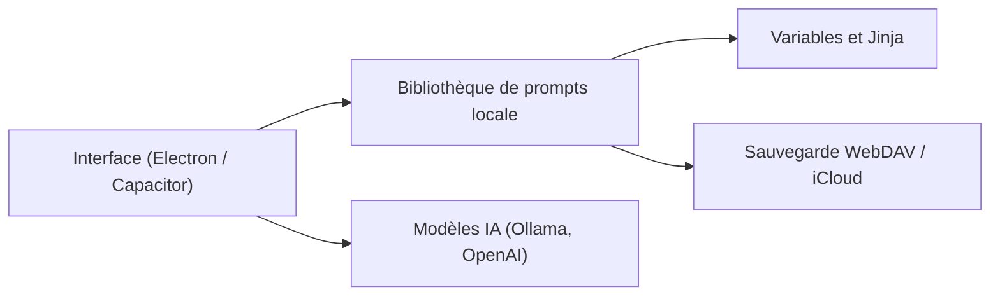

# yarin-zhang/AI-Gist

> Gestionnaire local de prompts avec variables et modèles Jinja, pour Windows, macOS, Linux, Android et iOS.

## Le problème
Les prompts utiles sont éparpillés dans des notes et des historiques, sans variables ni versions pour les réutiliser.

## Ce que ça fait vraiment
AI Gist classe les prompts par tags, catégories, notes et favoris, avec vues cartes, tableau et dossiers. Les variables s'écrivent `{{nom}}` et les modèles Jinja sont acceptés. Il peut générer, affiner ou extraire les variables d'un prompt via un modèle (Ollama, LM Studio, OpenAI, DeepSeek). Données locales, export CSV, sauvegarde WebDAV ou iCloud. README en chinois.

## Comment c'est branché
Schéma simplifié d'après la fiche, sans diagramme fourni.


## Essayer
```bash
yarn install
yarn dev
yarn dev:web
yarn build
```
Pour Linux : `chmod +x ai-gist-linux.AppImage`.

## Coût et pièges
Gratuit ; les modèles en ligne utilisent tes propres clés, et les modèles locaux tes ressources. Les anciens binaires macOS non signés demandent `xattr -cr`. Les téléchargements GitHub peuvent être lents depuis la Chine (miroirs fournis).

## Ce que ce n'est pas
Ce n'est pas une plateforme de partage de prompts : tout reste local par défaut. Ce n'est pas un orchestrateur d'agents. La licence AGPL impose ses conditions en cas de redistribution modifiée.

## Alternatives
Aucune alternative nommée dans le README.

## Pour toi
À surveiller : utile pour tenir une bibliothèque de prompts versionnée et locale, mais projet d'une seule personne et README en chinois.

