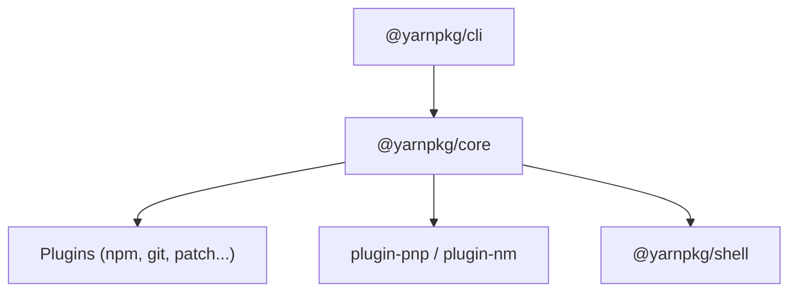

# yarnpkg/berry

> Modern, plugin-based Yarn package manager with workspaces, for JavaScript projects.

## The problem
Managing JavaScript dependencies reproducibly, with monorepos, without depending on a single installation mode.

## What it actually does
Yarn is split into packages. It natively handles workspaces, loads plugins (git, npm, patch, Plug'n'Play, node_modules) and ships a portable shell for scripts. It is also a Node API (`@yarnpkg/core`). The repository's dependencies are versioned in `.yarn/cache`.

## How it is wired
Simplified diagram based on the sheet, no diagram provided.


## Trying it
```bash
yarn build:cli
```

## Cost and gotchas
Free. Node is required; installation and migration point to the online guides. Third-party plugins are loaded by the URL of a single JavaScript file.

## What it is not
Not a package registry: it reads from an npm-type registry. Nor is it limited to Node, but Node remains the default case.

## Alternatives
No alternative named in the README.

## For you
Ignore: useful only if you maintain a JavaScript interface around a data project, of no direct interest for your daily work.
