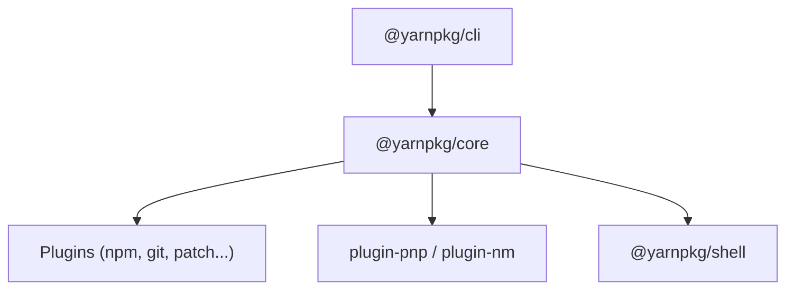

# yarnpkg/berry

> Gestionnaire de paquets Yarn moderne, à plugins, avec espaces de travail, pour projets JavaScript.

## Le problème
Gérer des dépendances JavaScript de façon reproductible, avec des monorepos, sans dépendre d'un seul mode d'installation.

## Ce que ça fait vraiment
Yarn est découpé en paquets. Il gère nativement les workspaces, charge des plugins (git, npm, patch, Plug'n'Play, node_modules) et embarque un shell portable pour les scripts. Il est aussi une API Node (`@yarnpkg/core`). Les dépendances du dépôt sont versionnées dans `.yarn/cache`.

## Comment c'est branché
Schéma simplifié d'après la fiche, sans diagramme fourni.


## Essayer
```bash
yarn build:cli
```

## Coût et pièges
Gratuit. Il faut Node ; l'installation et la migration renvoient aux guides en ligne. Les plugins tiers se chargent par URL d'un fichier JavaScript unique.

## Ce que ce n'est pas
Ce n'est pas un registre de paquets : il lit un registre de type npm. Ce n'est pas non plus limité à Node, mais Node reste le cas par défaut.

## Alternatives
Aucune alternative nommée dans le README.

## Pour toi
À ignorer : utile seulement si tu maintiens une interface JavaScript autour d'un projet data, sans intérêt direct pour ton quotidien.

