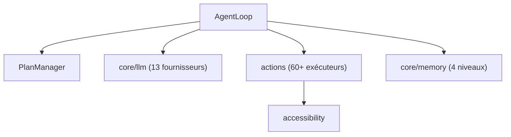

# yashab-cyber/opendroid

> Autonomous AI agent for Android that plans and carries out actions on the phone.

## The problem
Chaining actions on a phone (weather, SMS, alarm) means switching from one app to another.

## What it actually does
An Android app in Kotlin and Jetpack Compose: an agent engine plans in steps, executes, verifies and replans on failure. It drives the system through the accessibility service (WhatsApp, SMS, calls, settings), uses 13 LLM providers and local LiteRT-LM models, a 4-level memory and a voice interface.

## How it is wired


## Trying it
```bash
git clone https://github.com/JMAN730/opendroid.git
cd opendroid
./gradlew assembleDebug
```
The debug APK is produced at `app/build/outputs/apk/debug/app-debug.apk`.

## Cost and gotchas
JDK 21 and Android SDK 35 required. API key for the providers (Gemini has a free tier, Ollama works offline). Very broad permissions: accessibility, notifications, microphone.

## What it is not
Not a proven project: young (created in May 2026) and the README is very promotional. The clone URL points to a different owner than the cataloged repository. License not identified.

## Alternatives
No alternative named in the README.

## For you
Ignore: an agent that reads the screen and acts with extended permissions, with no clear license and no proof of maturity, has no place in your data/MLOps profile.
