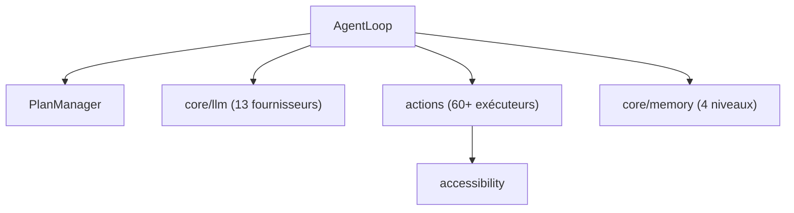

# yashab-cyber/opendroid

> Agent IA autonome pour Android qui planifie et exécute des actions sur le téléphone.

## Le problème
Enchaîner des actions sur un téléphone (météo, SMS, alarme) demande de passer d'une appli à l'autre.

## Ce que ça fait vraiment
Une appli Android en Kotlin et Jetpack Compose : un moteur d'agent planifie en étapes, exécute, vérifie et replanifie en cas d'échec. Elle pilote le système via le service d'accessibilité (WhatsApp, SMS, appels, réglages), utilise 13 fournisseurs LLM et des modèles locaux LiteRT-LM, une mémoire à 4 niveaux et une interface vocale.

## Comment c'est branché


## Essayer
```bash
git clone https://github.com/JMAN730/opendroid.git
cd opendroid
./gradlew assembleDebug
```
Le debug APK sort dans `app/build/outputs/apk/debug/app-debug.apk`.

## Coût et pièges
JDK 21 et Android SDK 35 requis. Clé d'API pour les fournisseurs (Gemini a un palier gratuit, Ollama fonctionne hors ligne). Permissions très larges : accessibilité, notifications, micro.

## Ce que ce n'est pas
Ce n'est pas un projet éprouvé : jeune (créé en mai 2026) et le README est très promotionnel. L'URL de clone pointe vers un autre propriétaire que le dépôt catalogué. Licence non identifiée.

## Alternatives
Aucune alternative nommée dans le README.

## Pour toi
Ignorer : un agent qui lit l'écran et agit avec des permissions étendues, sans licence claire ni preuve de maturité, n'a pas sa place dans ton profil data/MLOps.

