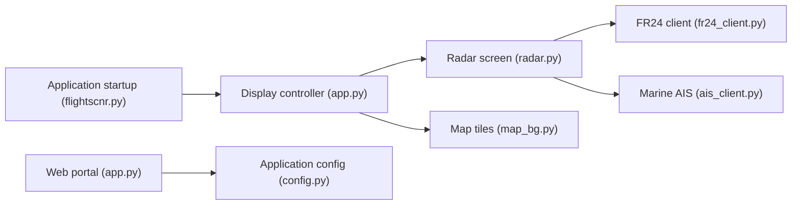

# yashmulgaonkar/FlightScnr_Pi

> Flight and ship tracker for a round Raspberry Pi touchscreen, for aviation enthusiasts.

## The problem
Track aircraft and boats around your home on a small dedicated display, with no computer or terminal needed for daily use.

## What it actually does
Shows an animated dark radar on a 720×720 screen, with flight details, a followed flight on a map, clock and weather. Sources: FR24, adsb.fi, local dump1090/readsb, AIS (aisstream.io), Tomorrow.io, LibreWXR, earthquakes and fires. LiveATC audio on a USB or Bluetooth speaker. A local web portal handles configuration and OTA updates.

## How it is wired


## Trying it
```bash
git clone https://github.com/yashmulgaonkar/FlightScnr_Pi.git ~/FlightScnr_Pi
cd ~/FlightScnr_Pi
sudo bash install-pi.sh
```

## Cost and gotchas
Hardware: a Raspberry Pi and a Waveshare screen (power cable mandatory on the 4-DSI-TOUCH-C). Several free API keys to create. The installer forces X11 and reboots. The README includes a repair script to run via `curl | bash`.

## What it is not
Not free in the commercial sense: the code is under CC BY-NC-SA 4.0 (non-commercial use, share-alike). The aisstream.io AIS feed is reported as unstable.

## Alternatives
No alternative named in the README (it says it is modeled on FlightScnr).

## For you
Ignore: a hobby hardware project, non-commercial license, outside your data/AI scope.
