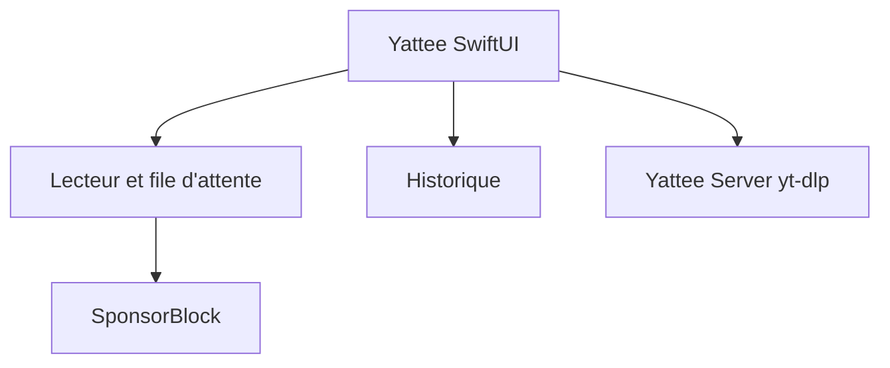

# yattee/yattee

> Alternative video player for Apple platforms (SwiftUI), with a queue, history and SponsorBlock.

## The problem
Watching online videos without the official app, using a customizable native player.

## What it actually does
The README is very short. It advertises a SwiftUI interface, a playback queue, history, controls and gestures, 4K playback, full screen, picture-in-picture, background audio and SponsorBlock category skipping. Version 2 is in preparation, with a self-hosted server based on yt-dlp.

## How it is wired
Simplified diagram based on the sheet, no diagram provided.


## Trying it
```bash
# Aucune commande dans le README : la version 2 passe par TestFlight et docs.yattee.stream.
```

## Cost and gotchas
Free, AGPL-3.0. The version 2 beta goes through TestFlight. The new server has to be self-hosted.

## What it is not
Not a video platform: it plays existing sources. The text says nothing about installation, legality or the exact platforms supported.

## Alternatives
No alternative named in the README.

## For you
Ignore: a video player for Apple devices, unrelated to data, AI or MLOps work.
