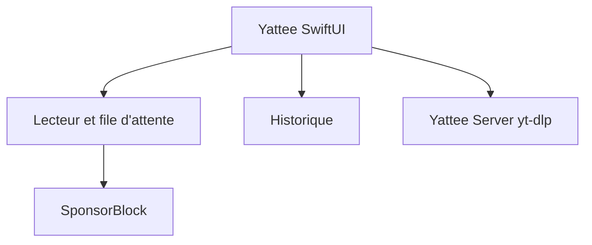

# yattee/yattee

> Lecteur vidéo alternatif pour Apple (SwiftUI), avec file d'attente, historique et SponsorBlock.

## Le problème
Regarder des vidéos en ligne sans l'application officielle, avec un lecteur natif personnalisable.

## Ce que ça fait vraiment
Le README est très court. Il annonce une interface SwiftUI, une file de lecture, un historique, des commandes et gestes, la lecture 4K, le plein écran, l'image dans l'image, l'audio en arrière-plan et le saut de catégories SponsorBlock. La version 2 est en préparation avec un serveur auto-hébergé basé sur yt-dlp.

## Comment c'est branché
Schéma simplifié d'après la fiche, sans diagramme fourni.


## Essayer
```bash
# Aucune commande dans le README : la version 2 passe par TestFlight et docs.yattee.stream.
```

## Coût et pièges
Gratuit, AGPL-3.0. La bêta de la version 2 passe par TestFlight. Le nouveau serveur est à auto-héberger.

## Ce que ce n'est pas
Pas une plateforme de vidéo : il lit des sources existantes. Le texte ne dit rien sur l'installation, la légalité ou les plateformes exactes.

## Alternatives
Aucune alternative nommée dans le README.

## Pour toi
À ignorer : lecteur vidéo pour Apple, sans rapport avec un travail data, IA ou MLOps.

