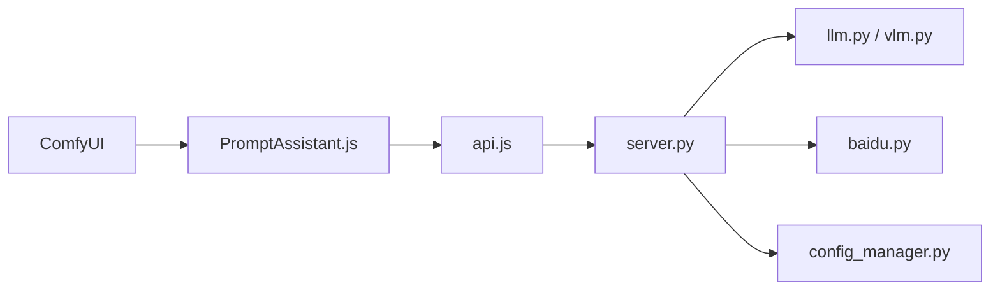

# yawiii/ComfyUI-Prompt-Assistant

> ComfyUI extension that optimizes, translates and reverse-describes prompts via cloud LLMs or Ollama, for ComfyUI users.

## The problem
Writing, translating and tweaking image prompts by hand in ComfyUI is repetitive, especially in bilingual Chinese/English.

## What it actually does
Adds a small assistant on the nodes' text fields: prompt expansion and optimization, translation (including notes, Markdown nodes, node documentation), reverse-description of images and video (beta). Handles favorite tags, history with undo/redo, customizable rules and several services (Baidu, Zhipu, xFlow, Ollama, OpenAI-compatible). User configuration lives in `user/default/prompt-assistant`.

## How it is wired


## Trying it
```bash
cd ComfyUI/custom_nodes
git clone https://github.com/yawiii/ComfyUI-Prompt-Assistant.git
# puis redémarrer ComfyUI ; ou installer « Prompt Assistant » via ComfyUI Manager
```

## Cost and gotchas
API key from the chosen provider (Baidu, Zhipu, xFlow...) or a local Ollama. Zhipu censors and returns empty output on refused content; migrate the config before the 2.0 update.

## What it is not
Not an image generator: it only acts on the surrounding text. README mainly in Chinese; video reverse-description is in beta. The repository's disclaimer rejects all responsibility for third-party services.

## Alternatives
No alternative named in the README.

## For you
Keep an eye on it: useful if you do a lot of ComfyUI with multilingual prompts, of no direct interest for an MLOps pipeline; GPL-3.0 and a single maintainer are reasons not to depend on it.
