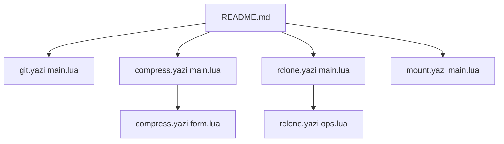

# yazi-rs/plugins

> Collection of official Lua plugins for the Yazi terminal file manager.

## The problem
The Yazi file manager does not include compression, disk mounting, Git preview or Rclone access by default.

## What it actually does
Each plugin lives in a `name.yazi` folder with a `main.lua`, installable with `ya pkg`. They include smart-enter, compress, git, mount, rclone, piper, chmod, diff and others. The larger ones split their logic into helper files.

## How it is wired

## Trying it
No command in this README: each plugin has its own README with the `ya pkg` command.

## Cost and gotchas
Free. You need Yazi up to date on `HEAD` (the README says so), which breaks compatibility with older versions.

## What it is not
Not the file manager itself.

## Alternatives
No alternative named in the README.

## For you
Ignore: terminal comfort for Yazi users, with no direct link to data, AI or MLOps work.
