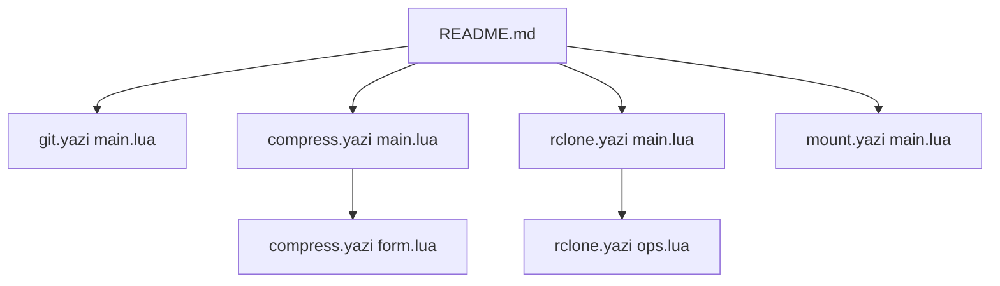

# yazi-rs/plugins

> Recueil de plugins Lua officiels pour le gestionnaire de fichiers en terminal Yazi.

## Le problème
Le gestionnaire de fichiers Yazi n'inclut pas par défaut compression, montage de disques, aperçu Git ni accès Rclone.

## Ce que ça fait vraiment
Chaque plugin vit dans un dossier `nom.yazi` avec un `main.lua`, installable par `ya pkg`. On y trouve smart-enter, compress, git, mount, rclone, piper, chmod, diff et d'autres. Les plus gros découpent leur logique en fichiers auxiliaires.

## Comment c'est branché

## Essayer
Aucune commande dans ce README : chaque plugin a son propre README avec la commande `ya pkg`.

## Coût et pièges
Gratuit. Il faut Yazi à jour sur `HEAD` (le README le rappelle), ce qui casse la compatibilité avec les anciennes versions.

## Ce que ce n'est pas
Pas le gestionnaire de fichiers lui-même.

## Alternatives
Aucune alternative nommée dans le README.

## Pour toi
À ignorer : confort de terminal pour utilisateurs de Yazi, sans rapport direct avec un travail data, IA ou MLOps.

