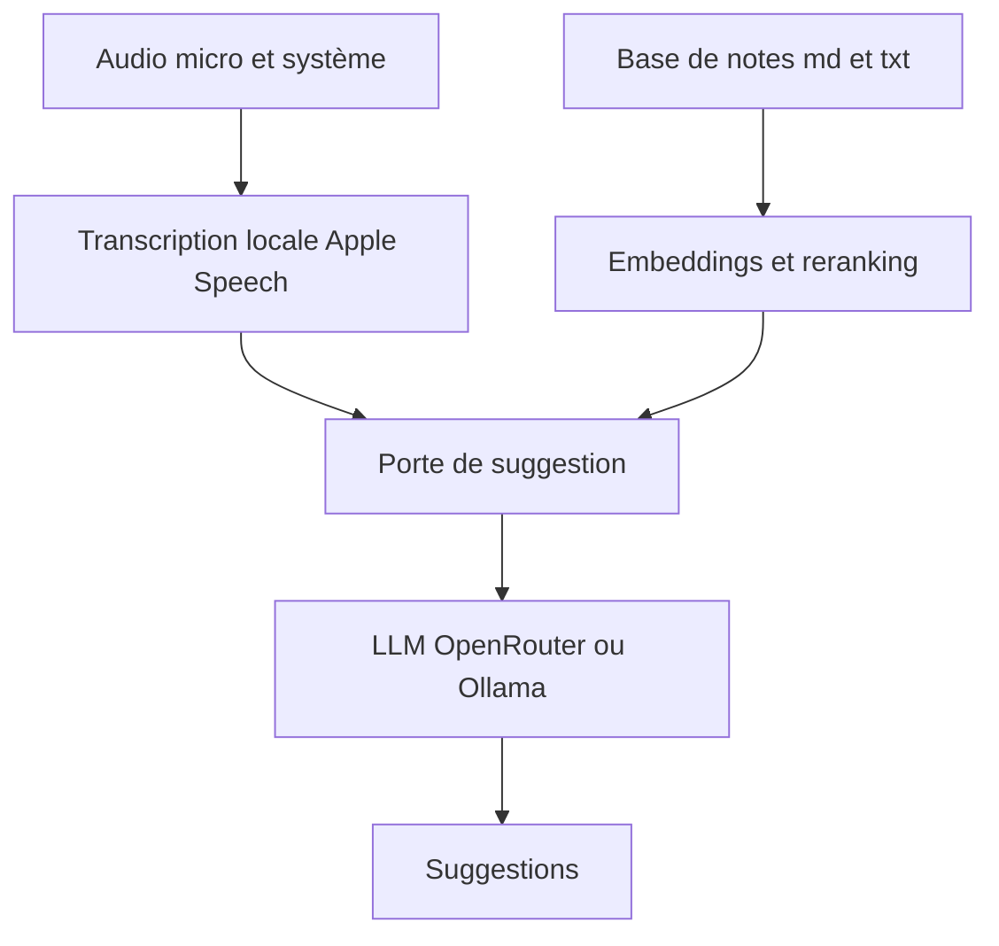

# yazinsai/OpenOats

> macOS application that transcribes a call live and suggests items from your notes.

## The problem
During a meeting, finding the right information in your notes in time is hard.

## What it actually does
Transcribes both sides of the call locally on the Mac. When a moment matters (question, decision), it searches a folder of `.md` or `.txt` notes and proposes talking points. Choice of models: OpenRouter or Ollama, embeddings from Voyage AI, Ollama or an OpenAI-compatible endpoint. Sessions saved in `~/Documents/OpenOats/`. Window hidden during screen sharing.

## How it is wired
Simplified diagram based on the fiche, no diagram provided.



## Trying it
```bash
brew tap yazinsai/openoats https://github.com/yazinsai/OpenOats
brew install --cask yazinsai/openoats/openoats
./scripts/build_swift_app.sh
```

## Cost and gotchas
Apple Silicon Mac, macOS 15 or later. Cloud mode: OpenRouter and Voyage AI keys. Local mode: Ollama. The first launch downloads a speech model of about 600 MB. Recording consent is mandatory.

## What it is not
Not a discreet recording tool that is legally neutral: the README warns about consent. In cloud mode, text (never audio) is sent to the providers.

## Alternatives
No alternative named in the README.

## For you
Worth watching: a clean example of a local RAG pipeline with Ollama on Mac, but limited to macOS and subject to the legal framework.
