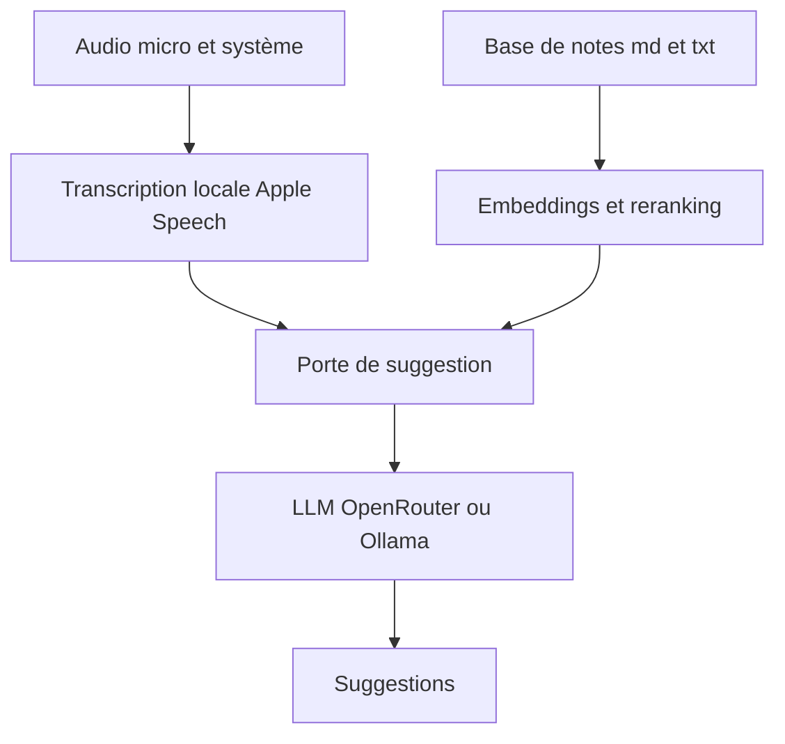

# yazinsai/OpenOats

> Application macOS qui transcrit un appel en direct et suggère des éléments de vos notes.

## Le problème
Pendant une réunion, retrouver à temps la bonne information dans ses notes est difficile.

## Ce que ça fait vraiment
Transcrit les deux côtés de l'appel localement sur Mac. Quand un moment compte (question, décision), cherche dans un dossier de notes `.md` ou `.txt` et propose des points à dire. Modèles au choix : OpenRouter ou Ollama, embeddings Voyage AI, Ollama ou point d'accès compatible OpenAI. Sessions sauvegardées dans `~/Documents/OpenOats/`. Fenêtre masquée au partage d'écran.

## Comment c'est branché
Schéma simplifié d'après la fiche, sans diagramme fourni.



## Essayer
```bash
brew tap yazinsai/openoats https://github.com/yazinsai/OpenOats
brew install --cask yazinsai/openoats/openoats
./scripts/build_swift_app.sh
```

## Coût et pièges
Mac Apple Silicon, macOS 15 ou plus. Mode cloud : clés OpenRouter et Voyage AI. Mode local : Ollama. Le premier lancement télécharge un modèle vocal d'environ 600 Mo. Obligation de consentement à l'enregistrement.

## Ce que ce n'est pas
Pas un outil d'enregistrement discret légalement neutre : le README met en garde sur le consentement. En mode cloud, du texte (jamais l'audio) part chez les fournisseurs.

## Alternatives
Aucune alternative nommée dans le README.

## Pour toi
À surveiller : exemple propre de pipeline RAG local avec Ollama sur Mac, mais usage limité à macOS et soumis au cadre légal.

