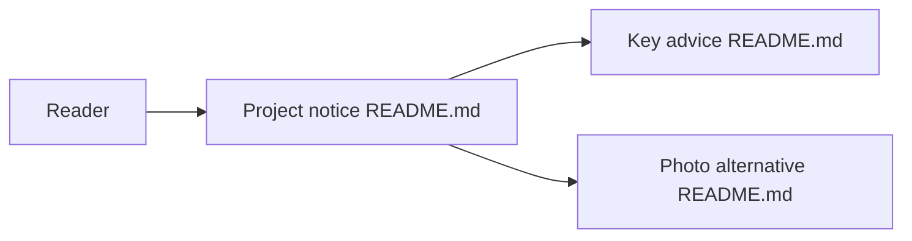

# ycccccccy/wx_key

> Satirical repository reduced to a README, with no code, after a DMCA notice.

## The problem
The project aimed to export your own WeChat 4.0+ chats, until a DMCA cease-and-desist.

## What it actually does
Nothing executable: the README replaces the code with an ironic text. It explains that the code was removed, offers parodic "methods" and suggests photographing the screen as an alternative. No software component is documented.

## How it is wired

## Trying it
No real command is documented: the README blocks are parodies.

## Cost and gotchas
No cost. Gotcha: the repository no longer has any code, so there is nothing to use or audit.

## What it is not
Neither an export tool nor an active project. License "none" according to the catalog, the README mentions a "parody license".

## Alternatives
No alternative named in the README.

## For you
Ignore: the repository is empty of code and its only interest is showing a removal under DMCA pressure.
