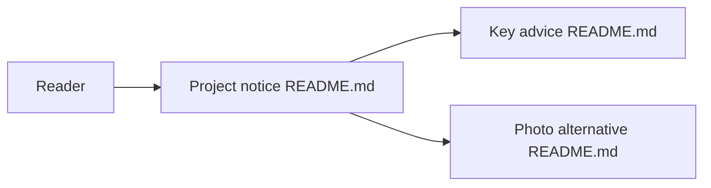

# ycccccccy/wx_key

> Dépôt satirique réduit à un README, sans code, après une notification DMCA.

## Le problème
Le projet voulait exporter ses propres chats WeChat 4.0+, jusqu'à une mise en demeure DMCA.

## Ce que ça fait vraiment
Rien d'exécutable : le README remplace le code par un texte ironique. Il explique que le code a été retiré, propose des « méthodes » parodiques et suggère de photographier l'écran en guise d'alternative. Aucun composant logiciel n'est documenté.

## Comment c'est branché

## Essayer
Aucune commande réelle n'est documentée : les blocs du README sont des parodies.

## Coût et pièges
Aucun coût. Piège : le dépôt n'a plus de code, donc rien à utiliser ni à auditer.

## Ce que ce n'est pas
Ni un outil d'export, ni un projet actif. Licence « aucune » selon le catalogue, le README évoque une « licence parodique ».

## Alternatives
Aucune alternative nommée dans le README.

## Pour toi
Ignorer : le dépôt est vide de code et son seul intérêt est de montrer un retrait sous pression DMCA.

