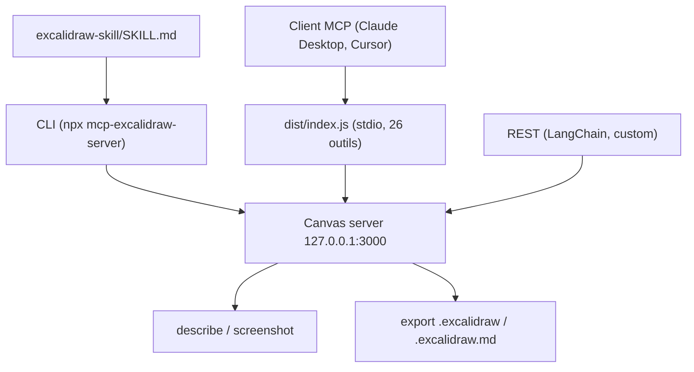

# yctimlin/mcp_excalidraw

> A local Excalidraw canvas that the coding agent draws on, looks at, fixes and commits.

## The problem
An agent that "makes a diagram" outputs a single image: truncated labels, crossing arrows,
and nothing reusable in the repository.

## What it actually does
Launches a local canvas server (Excalidraw UI + REST API + WebSocket sync on
`http://127.0.0.1:3000`, auto-started since v1.1) that can be driven through three facades: a
composable CLI (JSON in/out, useful exit codes), a stdio MCP server with 26 tools,
or plain HTTP. The agent creates elements one by one, calls `describe` (text summary) and
`screenshot` (PNG) to see its own work, fixes it, then `export`s an `.excalidraw` file
placed in the repository. Deterministic exports since v2.0: stable ids, seeds and key order,
so no false git diffs.

## How it is wired


## Trying it
```bash
npx -y mcp-excalidraw-server start
open http://127.0.0.1:3000   # browser tab enables screenshots & mermaid
npx -y mcp-excalidraw-server describe
npx -y mcp-excalidraw-server screenshot --out diagram.png
npx -y mcp-excalidraw-server export --out docs/architecture.excalidraw
npx -y mcp-excalidraw-server install-skill --dir <skills-root>
claude mcp add excalidraw --scope user -- npx -y mcp-excalidraw-server
```

## Cost and gotchas
Node ≥ 20 required since v2.0, MIT, no API key. The canvas is **in memory**:
restarting the server erases everything, so you must export or take a snapshot. Screenshots, PNG/SVG
export, viewport and Mermaid conversion require an open browser tab (exit code 4
otherwise). The server has no authentication: do not expose it with `HOST=0.0.0.0` without
network controls in front.

## What it is not
It is not the official Excalidraw MCP, which is a chat widget "prompt in, diagram
out". Here there is no image generation: the agent places the elements. Sharing via
`share` uploads an encrypted scene to excalidraw.com — it is the only outgoing call.

## Alternatives
- The official Excalidraw MCP: better for a throwaway diagram in a conversation.

## For you
The right tool for turning architecture diagrams into versioned artifacts of the repository.
