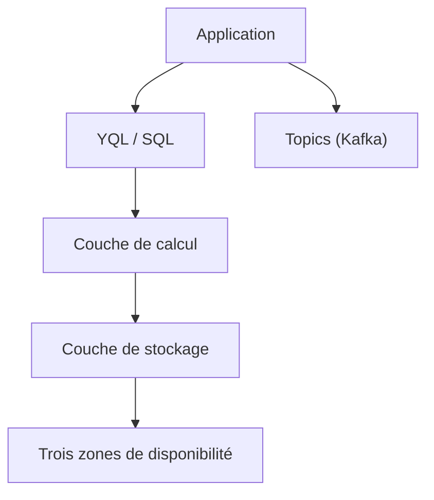

# ydb-platform/ydb

> Distributed, transactional and scalable SQL database, for high-load web services.

## The problem
Classic databases do not scale horizontally, and NoSQL ones give up cross-row transactions.

## What it actually does
Row or column tables for transactional and analytical use, persistent queues (topics), ACID transactions across several nodes, the YQL dialect, PostgreSQL- and Kafka-compatible modes. Storage and compute scale separately, and a cluster survives the loss of a zone. The README cites installations of more than 10,000 nodes.

## How it is wired
Schéma simplifié d'après la fiche, sans diagramme fourni.


## Trying it
```bash
# Aucune commande dans le README : suivre le Quick Start de la documentation
# (cluster à un nœud) ; Ansible ou Kubernetes pour un vrai cluster ; build via BUILD.md.
```

## Cost and gotchas
Free, but 8 GB of RAM minimum and a multi-node deployment to test fault tolerance. There are more than 5,000 open issues.

## What it is not
It is not a lightweight database for a prototype: it is a distributed system to operate. Nor a pure analytical warehouse.

## Alternatives
No alternative named in the README.

## For you
Worth watching: interesting for a large-scale transactional data platform, too heavy for one-off use.
