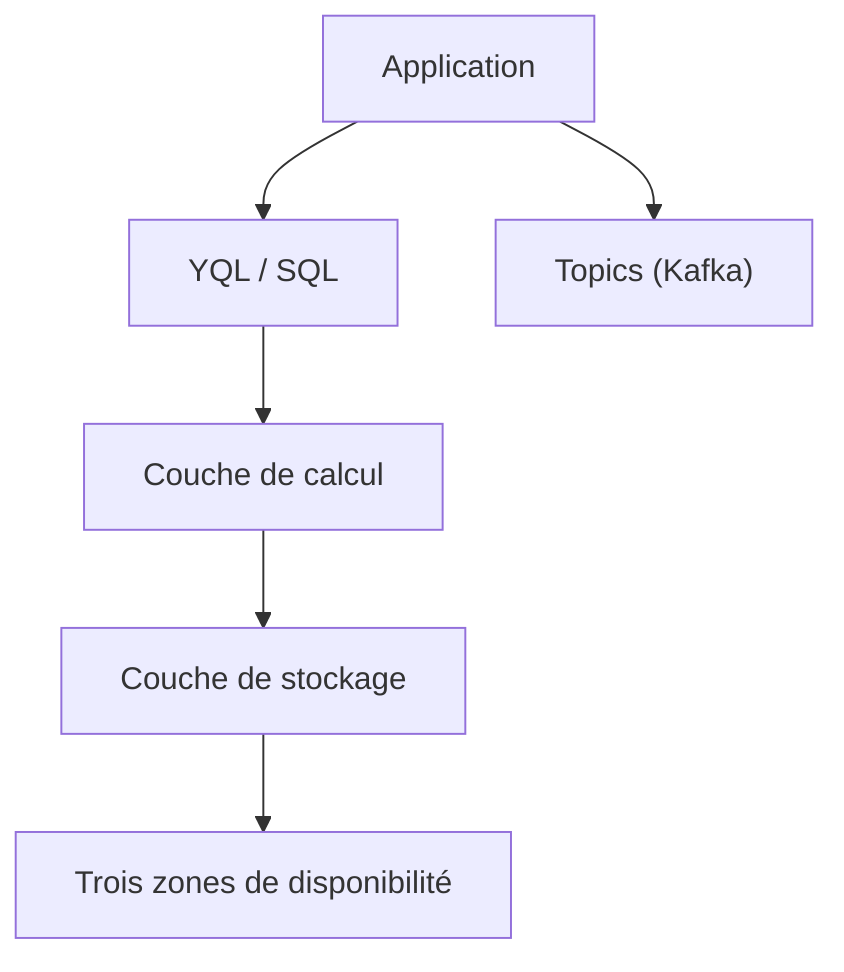

# ydb-platform/ydb

> Base de données SQL distribuée, transactionnelle et évolutive, pour services web à forte charge.

## Le problème
Les bases classiques ne passent pas à l'échelle horizontalement, et les NoSQL abandonnent les transactions entre lignes.

## Ce que ça fait vraiment
Tables en lignes ou en colonnes pour usage transactionnel et analytique, files persistantes (topics), transactions ACID sur plusieurs nœuds, dialecte YQL, modes compatibles PostgreSQL et Kafka. Stockage et calcul évoluent séparément, et un cluster survit à la perte d'une zone. Le README cite des installations de plus de 10 000 nœuds.

## Comment c'est branché
Schéma simplifié d'après la fiche, sans diagramme fourni.


## Essayer
```bash
# Aucune commande dans le README : suivre le Quick Start de la documentation
# (cluster à un nœud) ; Ansible ou Kubernetes pour un vrai cluster ; build via BUILD.md.
```

## Coût et pièges
Gratuit, mais 8 Go de RAM minimum et un déploiement multi-nœuds pour tester la tolérance aux pannes. Il y a plus de 5 000 issues ouvertes.

## Ce que ce n'est pas
Ce n'est pas une base légère pour un prototype : c'est un système distribué à exploiter. Ni un entrepôt analytique pur.

## Alternatives
Aucune alternative nommée dans le README.

## Pour toi
À surveiller : intéressant pour une plateforme de données transactionnelle à grande échelle, trop lourd pour un usage ponctuel.

